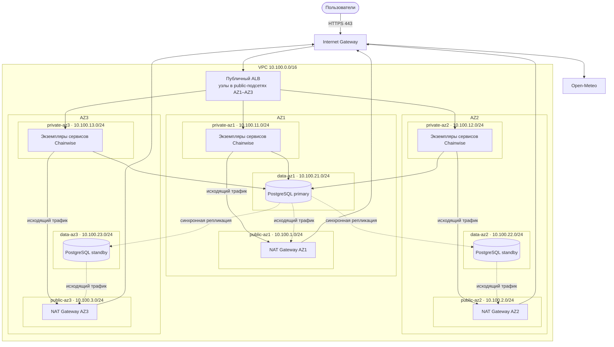

# Проект облачной инфраструктуры Chainwise

## Описание сервиса

**Название сервиса:** Chainwise

**Тип сервиса:** веб-приложение для контроля состояния велосипеда, планирования
его технического обслуживания и поездок, в соответствии с погодой

**Целевая аудитория:** велосипедисты, без привязки к географическому положению

**Основные пользовательские сценарии:**

1. Пользователь создаёт профиль велосипеда и указывает его текущий пробег
2. Пользователь записывает новую поездку, после чего сервис обновляет пробег и
   прогноз обслуживания цепи, тормозов и других компонентов велосипеда
3. Пользователь получает рекомендации по смазке или замене цепи, проверке
   тормозов и шин, а также прохождению полного технического обслуживания
4. Пользователь получает совет о готовности к поездке с учётом текущей погоды и
   напоминание о следующем обслуживании

### Состав системы

| Сервис | Назначение | Особенности, важные для архитектуры |
| --- | --- | --- |
| `frontend` | Веб-интерфейс Chainwise | Публичный HTTP/HTTPS-сервис; отображает профиль, поездки и рекомендации |
| `bike-api` | Работа с профилем велосипеда и поездками | Основная точка входа API; маршруты `/bike/*`; обращается к `maintenance-api` и PostgreSQL |
| `maintenance-api` | Расчёт рекомендаций и прогноза обслуживания | Внутренний HTTP-сервис; маршрут `/maintenance/*`; не должен быть доступен напрямую из интернета |
| `weather-api` | Получение погоды и оценка погодного риска | Внутренний HTTP-сервис; маршрут `/weather/*`; нуждается в исходящем доступе к Open-Meteo |
| `reminder-api` | Расчёт и создание напоминаний | Внутренний HTTP-сервис; маршруты `/reminders/*` |
| `user-api` | Профиль пользователя и настройки уведомлений | Внутренний HTTP-сервис; маршруты `/users/*` |
| PostgreSQL | Хранение пользователей, велосипедов, поездок и истории обслуживания | Размещается только в закрытых data-подсетях; доступ разрешён только прикладным API-сервисам |

## Этап 1. Проектирование VPC

### 1.1. Обоснование CIDR

Для VPC выбран приватный адресный диапазон `10.100.0.0/16`. Он относится к
диапазону RFC 1918 `10.0.0.0/8` и не маршрутизируется напрямую через интернет.

На рабочем компьютере используются домашняя сеть `192.168.3.0/24`, Docker-сети
`172.17.0.0/16` и `172.18.0.0/16`, а также несколько виртуальных сетей из
диапазонов `172.16.0.0/12` и `192.168.0.0/16`. Выбранный CIDR с ними не
пересекается. Корпоративная сеть, с которой требовалось бы обеспечить VPN- или
Direct Connect-связность, отсутствует.

Префикс `/16` предоставляет 65 536 адресов от `10.100.0.0` до
`10.100.255.255`. Этого достаточно, чтобы выделить отдельные public, private и
data-подсети в каждой из трёх зон доступности и сохранить большой резерв для
масштабирования и будущих лабораторных работ.

### 1.2. Таблица подсетей

Все подсети имеют префикс `/24`. Единый размер упрощает адресный план, а ёмкости
каждой подсети достаточно для текущей архитектуры Chainwise. Подсети
сгруппированы по назначению: `.1–.3` — public, `.11–.13` — private, `.21–.23` —
data.

| Зона | Подсеть | CIDR | Тип | Маршрут по умолчанию |
| --- | --- | --- | --- | --- |
| AZ1 | `public-az1` | `10.100.1.0/24` | public | Internet Gateway |
| AZ1 | `private-az1` | `10.100.11.0/24` | private | NAT Gateway AZ1 |
| AZ1 | `data-az1` | `10.100.21.0/24` | data | NAT Gateway AZ1 |
| AZ2 | `public-az2` | `10.100.2.0/24` | public | Internet Gateway |
| AZ2 | `private-az2` | `10.100.12.0/24` | private | NAT Gateway AZ2 |
| AZ2 | `data-az2` | `10.100.22.0/24` | data | NAT Gateway AZ2 |
| AZ3 | `public-az3` | `10.100.3.0/24` | public | Internet Gateway |
| AZ3 | `private-az3` | `10.100.13.0/24` | private | NAT Gateway AZ3 |
| AZ3 | `data-az3` | `10.100.23.0/24` | data | NAT Gateway AZ3 |

Public-подсети используют маршрут `0.0.0.0/0` через Internet Gateway. Ресурсы в
private и data-подсетях не имеют публичных IP-адресов и направляют исходящий
трафик через NAT Gateway, расположенный в public-подсети той же зоны. Отдельный
NAT Gateway в каждой зоне устраняет единую точку отказа и исключает зависимость
исходящего трафика одной зоны от работоспособности другой.

NAT выбран вместо VPC Endpoint, поскольку Chainwise требуется универсальный
исходящий доступ к внешним сервисам, включая Open-Meteo, а Endpoint предоставляет
приватный доступ только к конкретному сервису облачного провайдера. В текущей
архитектуре таких зависимостей нет. При последующем добавлении объектного
хранилища для резервных копий соответствующий VPC Endpoint можно использовать
совместно с NAT Gateway.

### 1.3. Сетевая диаграмма

В public-подсетях размещаются публичный Application Load Balancer и NAT Gateway каждой зоны. Все экземпляры Chainwise работают без публичных IP-адресов в private-подсетях, а узлы PostgreSQL в изолированных data-подсетях.

Публичный ALB распределён по трём public-
подсетям, а группы приложений представлены во всех трёх зонах. API не получает
публичного IP: внешние запросы проходят через ALB, где завершается TLS и
проверяется работоспособность целевых экземпляров. PostgreSQL представлен
кластером из primary и двух реплик.

## Этап 2. Балансировщики нагрузки

Для внешнего трафика выбран публичный ALB уровня L7. Он
завершает TLS, анализирует путь HTTP-запроса и направляет его в соответствующую
целевую группу. Логически это один ALB, но его управляемые узлы размещаются в
public-подсетях всех трёх зон доступности.

| Сервис | Тип балансировщика | Уровень | Правило маршрутизации | Стратегия |
| --- | --- | --- | --- | --- |
| `frontend` | Публичный ALB | L7 | `/`, `/check` и остальные пути по умолчанию → frontend target group, порт 8080 | Round Robin |
| `bike-api` | Публичный ALB | L7 | `/bike/*` → bike-api target group, порт 8081 | Least Outstanding Requests |

Listener на порту 80 выполняет перенаправление на HTTPS. Listener на порту 443
завершает TLS и применяет правила маршрутизации. Round Robin выбран для
frontend, поскольку его запросы короткие и примерно одинаковые. Для `bike-api`
используется Least Outstanding Requests: обработка запроса включает цепочку
вызовов внутренних сервисов и Open-Meteo, поэтому продолжительность операций
может различаться. Новый запрос направляется экземпляру с наименьшим числом
незавершённых запросов.

Для обеих целевых групп используются следующие параметры health check:

| Параметр | Значение |
| --- | --- |
| Протокол | HTTP |
| Путь | `/readyz` |
| Интервал | 15 секунд |
| Timeout | 5 секунд |
| Healthy threshold | 2 успешные проверки подряд |
| Unhealthy threshold | 3 неуспешные проверки подряд |
| Ожидаемый код | `200` |

Путь `/readyz` выбран вместо `/healthz`, поскольку балансировщику важно знать не
только то, что процесс запущен, но и то, что экземпляр готов принимать
пользовательский трафик.

`maintenance-api`, `weather-api`, `reminder-api` и `user-api` доступны только
внутри private-подсетей, для них не создаются отдельные балансировщики.

NLB уровня L4 в текущей архитектуре не требуется. Клиентский трафик Chainwise
является HTTP/HTTPS, а PostgreSQL использует endpoint кластера, который знает
роли primary и реплик. Обычный TCP-балансировщик не понимает эти роли и мог бы
направить операцию записи на read-only реплику. Если в будущем появится сервис с
необработанным TCP/UDP-трафиком, для него потребуется отдельный NLB.

## Этап 3. Связность с внешним миром

К VPC подключён Internet Gateway, через который публичный ALB принимает HTTPS-
запросы пользователей. Public-подсети содержат маршрут `0.0.0.0/0` к IGW.
Экземпляры приложений и PostgreSQL не имеют публичных IP-адресов и не принимают
входящие подключения из интернета.

Для исходящего доступа в каждой public-подсети размещается отдельный NAT
Gateway. Private и data-подсети используют NAT только своей зоны:

| Зона | Закрытые подсети | Исходящий маршрут |
| --- | --- | --- |
| AZ1 | `private-az1`, `data-az1` | NAT Gateway AZ1 - IGW |
| AZ2 | `private-az2`, `data-az2` | NAT Gateway AZ2 - IGW |
| AZ3 | `private-az3`, `data-az3` | NAT Gateway AZ3 - IGW |

Такая схема сохраняет исходящий доступ в двух оставшихся зонах при полном отказе
третьей и не направляет штатный трафик между зонами. IGW и
ALB являются управляемыми распределёнными компонентами, а
прикладные сервисы и PostgreSQL имеют экземпляры в нескольких AZ.

Если у компании появится собственный дата-центр, основным каналом связи с VPC
станет Direct Connect. Выделенное соединение обеспечивает более предсказуемые
пропускную способность и задержку, чем канал через публичный интернет. Резервным
каналом станет Site-to-Site VPN, его можно быстрее и дешевле организовать поверх
существующего интернет подключения.

Оба соединения используют динамическую маршрутизацию BGP. Маршруты Direct
Connect имеют больший приоритет. Если BGP сессия или физический канал Direct
Connect недоступны, его маршруты отзываются и трафик автоматически переходит на
маршруты Site-to-Site VPN. После восстановления основной маршрут снова получает
приоритет. VPN настраивается с двумя туннелями, а соединения завершаются на
разных пограничных устройствах, чтобы отказ одного канала или устройства не
разорвал связь между дата-центром и VPC.

## Этап 4. Безопасность и логирование

Security Groups проектируются по принципу минимальных привилегий. В правилах
между сервисами используются ссылки на другие Security Groups, а не IP-адреса
экземпляров, поэтому масштабирование или замена экземпляра не требуют изменения
правил. Поскольку Security Groups являются stateful (в отличие от NACL), ответный трафик для
разрешённого соединения пропускается автоматически.

### 4.1. Правила Security Groups

| Security Group | Входящий трафик | Исходящий трафик | Назначение |
| --- | --- | --- | --- |
| `SG-ALB` | TCP 443 от `0.0.0.0/0`; TCP 80 от `0.0.0.0/0` только для перенаправления на HTTPS | TCP 8080 к `SG-Frontend`; TCP 8081 к `SG-Bike` | Единственная публичная точка входа |
| `SG-Frontend` | TCP 8080 только от `SG-ALB` | TCP 8081 только к `SG-Bike` | Web frontend без публичного IP |
| `SG-Bike` | TCP 8081 от `SG-ALB` и `SG-Frontend` | TCP 8082 к `SG-Maintenance`; TCP 5432 к `SG-Database` | Публично маршрутизируемая часть API и доступ к данным |
| `SG-Maintenance` | TCP 8082 только от `SG-Bike` | TCP 8083 только к `SG-Weather` | Расчёт рекомендаций |
| `SG-Weather` | TCP 8083 только от `SG-Maintenance` | TCP 8084 к `SG-Reminder`; TCP 443 через NAT для Open-Meteo | Погода и внешний HTTPS-вызов |
| `SG-Reminder` | TCP 8084 только от `SG-Weather` | TCP 8085 только к `SG-User` | Расчёт напоминаний |
| `SG-User` | TCP 8085 только от `SG-Reminder` | Нет прикладных исходящих соединений | Настройки пользователя |
| `SG-Database` | TCP 5432 только от `SG-Bike`; TCP 5432 от самой `SG-Database` для репликации | TCP 5432 только к `SG-Database` для репликации | PostgreSQL в data-подсетях |
| NAT Gateway | Security Group не поддерживается | Определяется маршрутами и правилами исходящего трафика ресурсов | Управляемый шлюз исходящего доступа |

Для исходящего HTTPS-запроса к Open-Meteo Security Group ограничивает порт, но
не доменное имя, стандартные SG работают с адресами, протоколами и портами. Если
потребуется строгое ограничение по домену, перед внешним API следует поставить
контролируемый egress proxy или сетевой firewall.

К управляемому NAT Gateway Security Group не прикрепляется. Его использование
контролируется маршрутами private и data-подсетей, исходящими правилами SG
ресурсов и Network ACL public-подсети.

### 4.2. VPC Flow Logs

VPC Flow Logs включаются для всей VPC с регистрацией как принятых (`ACCEPT`),
так и отклонённых (`REJECT`) соединений. Записи отправляются в централизованное
хранилище логов, где по ним строятся поиск, метрики и оповещения. В каждой записи
сохраняются source и destination IP, порты, протокол, результат фильтрации,
временной интервал, число пакетов и объём трафика. Содержимое пакетов, HTTP-тела и
секреты в Flow Logs не записываются.

Для Chainwise по Flow Logs можно обнаруживать:

- множество `REJECT` на порт PostgreSQL `5432` за короткий промежуток времени от
  одного source IP — признак сканирования или подбора доступа;
- перебор разных портов одного ресурса;
- попытки обратиться к базе не из разрешённой группы API;
- неожиданные соединения между подсетями;
- аномально большой объём исходящего трафика, который может указывать на утечку
  данных или компрометацию экземпляра.

При превышении порога отклонённых соединений система мониторинга создаёт
оповещение. Инженер определяет исходный интерфейс или экземпляр, проверяет его
прикладные и системные логи, при необходимости изолирует ресурс отдельной
Security Group и блокирует внешний источник на сетевом периметре. Flow Logs
показывают факт и направление соединения, а причину запроса устанавливают по
логам соответствующего сервиса.

## Этап 5. Оформление отчёта

### 5.1. Выводы

В ходе работы стало понятнее, чем отличаются балансировщики уровней L4 и L7 и
почему тип балансировщика выбирается по протоколу и необходимым правилам
маршрутизации, а не только по тому, является сервис публичным или внутренним.
Для Chainwise выбран L7 ALB, поскольку он анализирует HTTP-пути и направляет
запросы в разные целевые группы. Новым также стало назначение VPC Flow Logs:
они фиксируют метаданные принятых и отклонённых сетевых соединений и позволяют
обнаруживать сканирование портов, запрещённые подключения и аномальный трафик.

В архитектуре удалось избежать нескольких типичных ошибок. PostgreSQL не
размещён в публичной подсети и доступен на порту 5432 только от Security Group
API. Вместо одного общего NAT Gateway предусмотрен отдельный шлюз в каждой зоне
доступности, поэтому отказ одной AZ не лишает остальные зоны исходящего доступа.
Правила Security Groups ограничены необходимыми направлениями и портами, а
прикладные сервисы не получают собственные публичные IP-адреса. В результате
сеть сохраняет отказоустойчивость и уменьшает поверхность атаки.

### 5.2. Контрольные вопросы

#### 5.2.1. Чем VxLAN отличается от VLAN?

VLAN создаёт изолированные L2-сегменты с помощью 12-битного идентификатора,
поэтому число доступных VLAN ограничено примерно 4094. Этого недостаточно для
крупного облака с большим количеством клиентов и изолированных сетей. Кроме
того, обычный VLAN привязан к L2-домену, который неудобно расширять через
маршрутизируемую инфраструктуру.

VxLAN использует 24-битный VNI и поддерживает около 16 миллионов логических
сегментов. Он инкапсулирует Ethernet-кадры в UDP-пакеты и передаёт их поверх
маршрутизируемой L3 IP-сети между VTEP. Таким образом, VxLAN решает проблему
масштабирования количества сегментов и позволяет строить распределённую L2-
overlay-сеть поверх физической L3-инфраструктуры.

#### 5.2.2. ALB или NLB для gRPC и WebSocket?

Для gRPC и WebSocket в архитектуре Chainwise следует использовать ALB уровня
L7. gRPC обычно работает поверх HTTP/2, а WebSocket начинает соединение как
HTTP-запрос и использует механизм Upgrade. ALB понимает эти протоколы, может
завершать TLS, применять правила по host/path и выполнять HTTP health checks.

NLB уровня L4 рассматривался бы, если требовалось прозрачное проксирование TCP,
сохранение исходного протокола, статические IP-адреса или минимальная задержка
без анализа HTTP. Сам факт долгоживущего соединения не делает NLB обязательным:
уровень выбирается по необходимым функциям балансировки.

#### 5.2.3. Что произойдёт с CDN без Cache-Control и почему TTL важен для API?

Без заголовка `Cache-Control` CDN вынужден использовать собственные настройки
или эвристики. Он может не кэшировать ответ вообще, и тогда каждый запрос дойдёт
до приложения и базы данных, увеличивая нагрузку. Другой вариант — CDN применит
стандартный TTL и будет отдавать уже неактуальный ответ дольше, чем требуется.

TTL определяет время жизни ответа в кэше. Для версионированных статических файлов
допустим длинный TTL, а для изменяемых или персональных API-данных нужен короткий
TTL либо `Cache-Control: no-store`. Иначе пользователь Chainwise может увидеть
старый пробег или рекомендацию, а при ошибочном ключе кэша — данные другого
пользователя.

#### 5.2.4. Сколько NAT Gateway нужно в трёх зонах доступности?

Для production-сети с тремя AZ нужны три NAT Gateway — по одному в public-
подсети каждой зоны. Private- и data-подсети направляют исходящий трафик через
шлюз своей AZ. Один общий NAT стал бы единой точкой отказа: при недоступности его
зоны все закрытые подсети потеряли бы исходящий доступ. Размещение по одному
шлюзу в зоне также исключает штатную зависимость от межзонной маршрутизации.

#### 5.2.5. Чем Security Group отличается от Network ACL?

Security Group применяется на уровне сетевых интерфейсов ресурсов и является
stateful: если начальное соединение разрешено, ответный трафик для него
пропускается автоматически. Одну SG можно прикрепить к нескольким экземплярам,
но её правила всё равно проверяются на уровне этих ресурсов. В AWS Security
Groups содержат разрешающие правила без явного `deny`.

Network ACL действует на границе всей подсети и является stateless. Входящий и
исходящий трафик проверяются независимо, поэтому для разрешённого входящего
запроса необходимо отдельно разрешить исходящий ответ, включая временные порты
клиента. Иначе сервер получит запрос, но ответ будет заблокирован. NACL
поддерживает как разрешающие, так и запрещающие правила, обрабатываемые по
номерам.

#### 5.2.6. Почему базу данных нельзя размещать в public-подсети?

Публично доступный PostgreSQL постоянно подвергался бы сканированию, подбору
паролей, попыткам эксплуатации уязвимостей и перегрузке соединениями. Пароль и
Security Group снижают риск, но не устраняют последствия ошибочного правила,
утечки учётных данных или новой уязвимости. Прямое подключение к базе также
позволяет обойти проверки авторизации и аудит на уровне приложения.

Поэтому PostgreSQL размещается в data-подсетях без публичных IP-адресов. Порт
5432 разрешён только от `SG-Bike`, а административный доступ должен выполняться
через отдельный контролируемый канал. Это уменьшает поверхность атаки и не
позволяет внешнему клиенту обратиться к базе напрямую.

#### 5.2.7. Для чего нужны VPC Flow Logs?

VPC Flow Logs сохраняют метаданные сетевых потоков: адреса и порты источника и
назначения, протокол, результат `ACCEPT` или `REJECT`, время и объём трафика. Они
нужны для расследования проблем связности и обнаружения подозрительной сетевой
активности.

Например, множество `REJECT` на порт PostgreSQL `5432` за короткое время от
одного source IP указывает на сканирование или попытку подбора доступа. По Flow
Logs также можно увидеть перебор разных портов, неожиданные соединения между
подсетями и аномальный исходящий трафик. Содержимое пакетов Flow Logs не
записывают, поэтому причину запроса дополнительно проверяют по логам приложения
и операционной системы.
