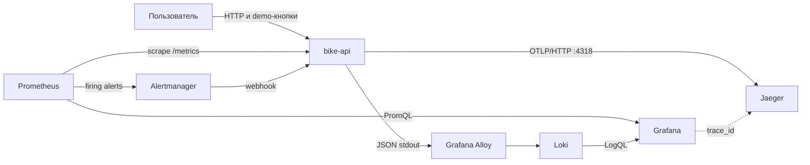
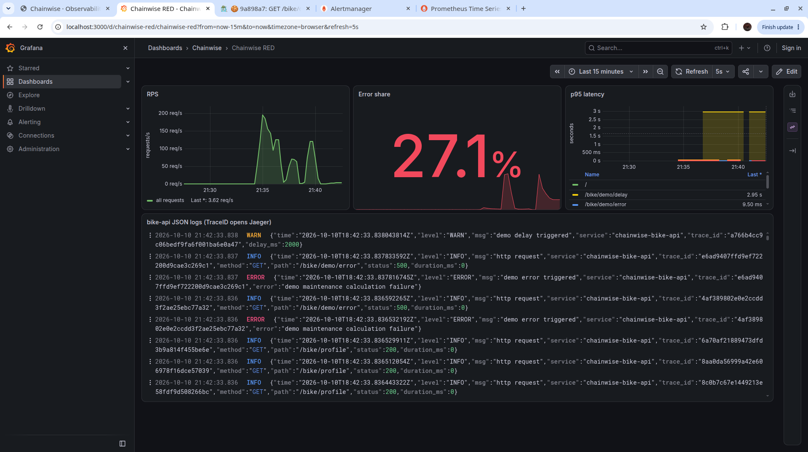
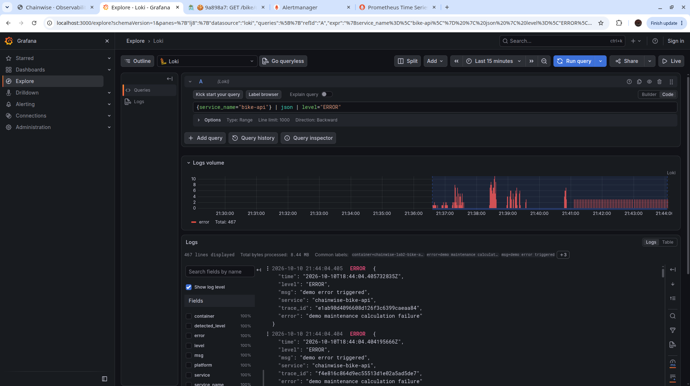
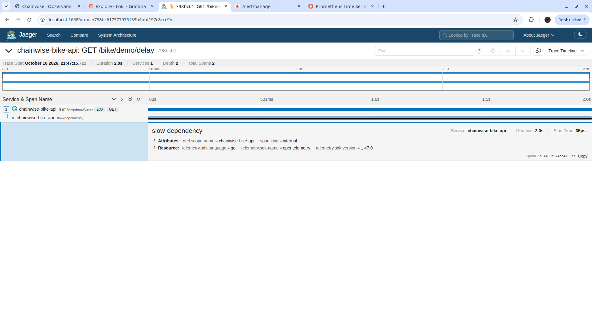
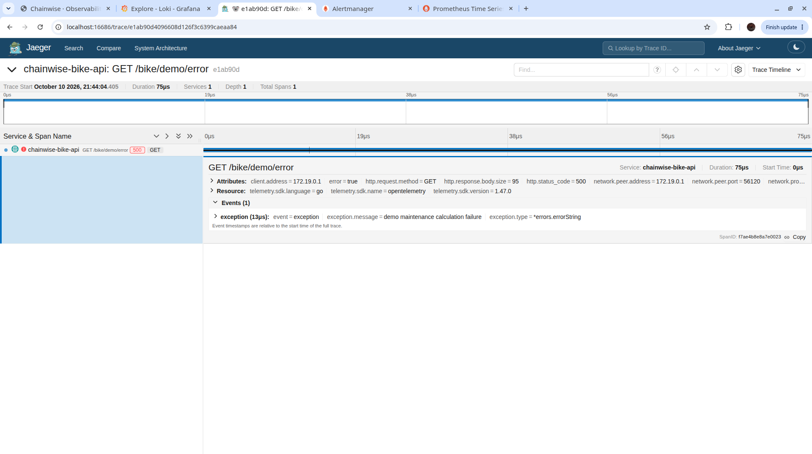
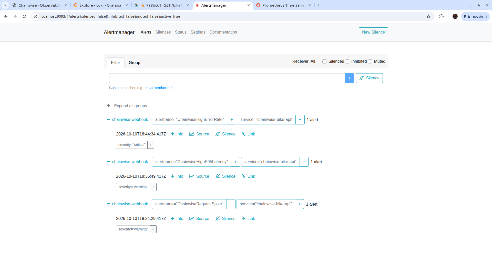

# Лабораторная работа №2. Полный мониторинг сервиса Chainwise

## 1. Цель работы

Цель работы — развернуть для одного сервиса все три основных вида
данных наблюдаемости: метрики, структурированные логи и распределённые трейсы, а
также настроить правила оповещения. В качестве сервиса выбран `bike-api` из
архитектуры Chainwise, спроектированной в лабораторной работе №1.

Стенд развёрнут локально с помощью Docker Compose.

## 2. Состав и схема стенда

В стенд входят `bike-api`, Prometheus, Grafana, Loki, Grafana Alloy, Jaeger и
Alertmanager. Grafana Alloy используется как актуальный эквивалент Promtail для
сбора stdout Docker-контейнера.

Внешние порты стенда:

| Компонент | Порт | Назначение |
| --- | --- | --- |
| `bike-api` | 8081 | UI, доменные маршруты, `/metrics`, health endpoints |
| Grafana | 3000 | RED-дашборд и логи |
| Prometheus | 9090 | Метрики, targets и rules |
| Alertmanager | 9093 | Состояние оповещений |
| Loki | 3100 | API логов |
| Jaeger | 16686 | UI трейсов |
| Jaeger OTLP | 4317, 4318 | Приём трейсов по gRPC и HTTP |
| Grafana Alloy | 12345 | Локальный служебный UI агента |

## 3. Реализация сервиса

Для лабораторной перенесён сервис `bike-api`. Он сохраняет маршруты
Chainwise `/bike/profile` и `/bike/check`, а также предоставляет страницу с тремя
демонстрационными действиями:

1. `/bike/demo/error` возвращает HTTP 500;
2. `/bike/demo/delay` выполняет медленную операцию продолжительностью две секунды;
3. `/bike/demo/load?count=120` создаёт всплеск внутренних запросов к профилю
   велосипеда.

Сервис написан на Go и упакован в Docker image. Для
балансировщиков и оркестраторов сохранены `/healthz` и `/readyz`.

## 4. Метрики

На `/metrics` публикуются счётчик всех HTTP-запросов, отдельный счётчик ответов
5xx и гистограмма длительности. Prometheus опрашивает сервис раз в пять секунд.

В Grafana был нарисован RED дашборд:

- RPS вычисляется как сумма `rate(chainwise_http_requests_total)`;
- доля ошибок — отношение скорости роста error counter к request counter;
- p95 — `histogram_quantile(0.95, ...)` по бакетам гистограммы.

## 5. Логи

`bike-api` пишет в stdout структурированные JSON-записи. Каждая запись запроса
содержит уровень, сообщение, сервис, HTTP-метод, путь, статус, длительность и
`trace_id`. Alloy выбирает контейнер по Docker Compose label
`service=bike-api` и отправляет его логи в Loki.

В Grafana используется запрос `{service_name="bike-api"} | json`. Для поля
`trace_id` настроен derived field, связанный с источником Jaeger. Это позволяет
перейти от сообщения об ошибке к конкретному trace без поиска по времени.

## 6. Трейсы

OpenTelemetry автоматически создаёт серверный span для каждого HTTP-запроса.
Экспорт выполняется напрямую в Jaeger по OTLP/HTTP. В обработчике задержки
создаётся дочерний span `slow-dependency`, поэтому waterfall показывает, где
потрачены две секунды.

При искусственной ошибке в span записывается событие `exception`, статус span
становится `Error`, а HTTP status становится 500.

## 7. Алерты

Настроены три обязательных правила:

| Правило | Условие | Обоснование |
| --- | --- | --- |
| `ChainwiseHighErrorRate` | Доля ответов 5xx больше 20% за 5 минут в течение 10 секунд | Обнаруживает массовый отказ пользовательских операций, независимо от общего числа запросов |
| `ChainwiseRequestSpike` | Средний RPS больше 0,3 за 5 минут в течение 5 секунд | Обнаруживает учебный burst из 120 запросов и предупреждает о риске исчерпания ресурсов |
| `ChainwiseHighP95Latency` | p95 медленного маршрута больше 1 секунды за 5 минут в течение 5 секунд | Обнаруживает деградацию, при которой запросы успешны, но слишком медленны |

После искусственной нагрузки с ошибками все три правила перешли в `firing`, а Alertmanager доставил уведомления в webhook
`/internal/alerts` сервиса.

