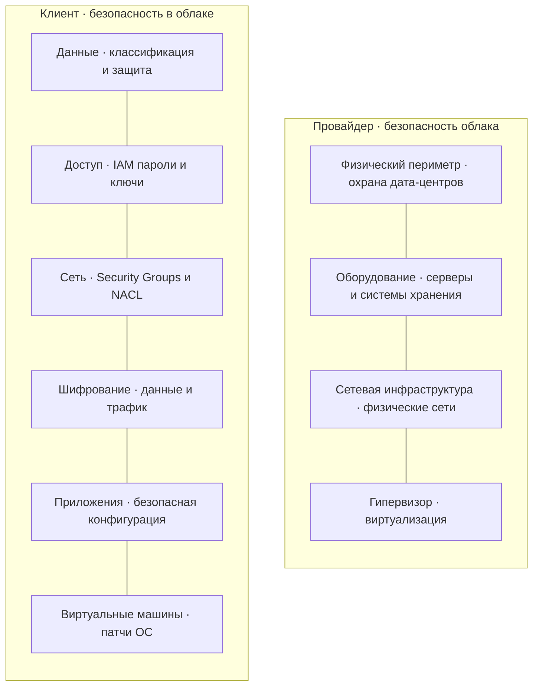
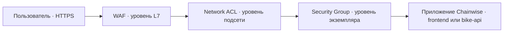

# Безопасность облачной инфраструктуры Chainwise

В работе проектируется защита облачной инфраструктуры Chainwise, описанной в
лабораторных работах №1 и №2. Состав VPC, адреса подсетей и схема подключения к
интернету остаются без изменений.

## Этап 1. Модель Shared Responsibility

### 1.1. Разделение ответственности

Облачный провайдер обеспечивает безопасность самого облака. В его зону входят
дата-центры, физическое оборудование, базовая сетевая инфраструктура,
гипервизор и средства виртуализации. Клиент отвечает за безопасность ресурсов,
которые он размещает в облаке: данные, учётные записи, настройки доступа,
шифрование, приложения и операционные системы виртуальных машин.



### 1.2. Граница ответственности в IaaS PaaS и SaaS

Базовая граница между зонами ответственности проходит на уровне гипервизора.
Провайдер защищает физическую инфраструктуру и слой виртуализации, а клиент
управляет тем, что развёрнуто поверх него. Объём клиентской настройки зависит от
модели предоставления сервиса.

| Модель и пример | Ответственность провайдера | Ответственность клиента |
| --- | --- | --- |
| IaaS, Amazon EC2 | Дата-центр, оборудование, физическая сеть, гипервизор и виртуализация | Гостевая ОС, установка патчей, приложения, Security Groups, IAM, шифрование и данные |
| PaaS, Amazon RDS | Инфраструктура, гипервизор, ОС сервера БД, установка исправлений и работа управляемого сервиса | Учётные записи БД, сетевой доступ, параметры экземпляра, схема БД, резервное копирование в пределах выбранных настроек и данные |
| SaaS, Microsoft 365 | Вся инфраструктура и само приложение, включая его обновление и доступность | Пользователи, MFA, права доступа, правила совместного использования, классификация и содержимое данных |

Переход от IaaS к SaaS уменьшает число компонентов, которыми управляет клиент,
но ответственность за данные не передаётся провайдеру. Клиент определяет, какие
данные загружать, кто получает к ним доступ и как долго они должны храниться.
Провайдер отвечает за защиту и доступность сервиса в пределах заявленной модели,
но не принимает бизнес-решения о содержимом и владельцах данных.

### 1.3. Утечка через неправильно настроенную Security Group

За утечку отвечает клиент. Security Group настраивается на стороне клиента и
относится к безопасности в облаке. Если клиент разместил базу данных в публичной
подсети и разрешил входящие подключения из интернета, провайдер выполнил именно
эту конфигурацию и не нарушил свою часть модели Shared Responsibility.

Для предотвращения такой ситуации PostgreSQL в Chainwise размещается в закрытых
data-подсетях без публичных IP-адресов. Правило `SG-Database` разрешает TCP-порт
`5432` только от `SG-Bike`, а NACL дополнительно ограничивает трафик на уровне
подсети. Изменения Security Groups, обращения к ключам и действия с учётными
записями должны попадать в журнал аудита.

## Этап 2. Управление доступом IAM

### 2.1. Политика сервисного аккаунта

Для CI-сервера создана точечная политика доступа к каталогу
`chainwise-ci/` в бакете `my-backup-bucket`. Разрешены только загрузка и чтение
объектов. Запрос должен приходить из диапазона `10.0.0.0/24`, указанного в
задании. Удаление объектов запрещено отдельным правилом `Deny`.

```json
{
  "Version": "2012-10-17",
  "Statement": [
    {
      "Sid": "AllowReadWriteChainwiseArtifacts",
      "Effect": "Allow",
      "Action": [
        "s3:PutObject",
        "s3:GetObject"
      ],
      "Resource": "arn:aws:s3:::my-backup-bucket/chainwise-ci/*",
      "Condition": {
        "IpAddress": {
          "aws:SourceIp": "10.0.0.0/24"
        }
      }
    },
    {
      "Sid": "DenyObjectDeletion",
      "Effect": "Deny",
      "Action": "s3:DeleteObject",
      "Resource": "arn:aws:s3:::my-backup-bucket/chainwise-ci/*"
    }
  ]
}
```

### 2.2. Сущности IAM

| Сущность | Кто это | Как подтверждает личность |
| --- | --- | --- |
| Пользователь (IAM User) | Человек, который работает с облачной консолью или API | Пароль и MFA, при программном доступе также могут использоваться ключи |
| Сервисный аккаунт | Нечеловеческая учётная запись приложения, CI/CD или скрипта | Ключи доступа или идентификация рабочей нагрузки с получением временного токена |
| Роль (IAM Role) | Набор временно получаемых разрешений, а не отдельный человек или приложение | Роль принимается доверенным пользователем или сервисом, после чего STS выдаёт временные учётные данные |

### 2.3. Принцип минимальных привилегий

Принцип least privilege означает, что субъект получает только те действия и
ресурсы, которые нужны для его текущей задачи. Если CI-сервер публикует файлы
Chainwise, правильная настройка разрешает `s3:PutObject` и `s3:GetObject` только
для префикса `my-backup-bucket/chainwise-ci/`. Доступ к другим каталогам,
бакетам и удалению объектов не выдаётся.

Плохой вариант состоит в передаче CI-серверу ключа администратора или разрешений
`s3:*` на ресурс `*`. При компрометации такого ключа злоумышленник сможет читать,
изменять и удалять данные во всех доступных бакетах.

### 2.4. Типичные ошибки IAM

| Ошибка | Последствие | Как предотвратить |
| --- | --- | --- |
| Использование ключа суперадминистратора для обычных операций | Компрометация одного ключа даёт контроль над всем облачным окружением | Создать отдельные роли и политики с минимальными разрешениями, root-аккаунт не использовать для повседневной работы |
| Долгоживущие ключи без ротации | Утёкший или забытый ключ продолжает работать и может попасть в репозиторий | Использовать временные учётные данные, задать регулярную ротацию и удалять неиспользуемые ключи |
| Отказ от ролей в пользу статических ключей | Секрет приходится хранить и передавать вместе с приложением | Назначать сервисам IAM Role и получать временные данные через STS |
| Отсутствие MFA у пользователей | Украденного пароля достаточно для входа в облако | Включить MFA, особенно для привилегированных пользователей |
| Широкий `*` в действиях или ресурсах | Субъект получает доступ к операциям и ресурсам, которые не нужны для его задачи | Перечислять конкретные действия, ARN бакета и при необходимости отдельный префикс объектов |


## Этап 3. Управление секретами

### 3.1. Сравнение Vault и AWS Secrets Manager

| Критерий | HashiCorp Vault | AWS Secrets Manager |
| --- | --- | --- |
| Платформа / привязка к облаку | Работает в разных облаках и локальной инфраструктуре | Нативный сервис AWS, рассчитанный на ресурсы этого облака |
| Динамические секреты (TTL) | Генерирует временные учётные данные, управляет lease и отзывает их после окончания TTL | Возможности динамических секретов ограничены, основной сценарий связан с хранением и ротацией существующих значений |
| Автоматическая ротация | Настраивается через secrets engine и правила Vault | Поддерживается как управляемая функция, особенно для RDS |
| Unseal / самоуправление | Требует развёртывания, unseal и самостоятельного обслуживания кластера | Unseal отсутствует, инфраструктурой сервиса управляет AWS |
| Стоимость и администрирование | Open-source версия доступна без платы за сервис, но требует ресурсов и времени на эксплуатацию | Оплачивается как облачный сервис, большая часть эксплуатации выполняется AWS |
| Интеграция с IAM | Использует собственные методы аутентификации, ACL и policies, также может связываться с облачными идентификаторами | Непосредственно использует AWS IAM и ресурсные политики |

Для инфраструктуры, полностью размещённой в AWS, логично выбрать AWS Secrets
Manager. Он интегрирован с IAM, KMS и RDS, поэтому требует меньше собственной
настройки. Для Chainwise выбран HashiCorp Vault, поскольку сервис не планируется
привязывать к AWS, а опыт работы с Vault уже есть. Такой вариант можно сохранить
при переносе приложения в другое облако или локальную инфраструктуру.

### 3.2. Чек-лист безопасного обращения с секретами

1. Не хранить пароли, токены и ключи в исходном коде, конфигурационных файлах репозитория и истории git
2. Хранить секреты в Vault в зашифрованном виде и передавать их приложению только во время выполнения
3. Использовать динамические секреты с ограниченным TTL или регулярно ротировать статические значения
4. Разрешать чтение каждого секрета только тем сервисным аккаунтам и ролям, которым он нужен
5. Включить аудит обращений к Vault и отслеживать получение, изменение и отзыв секретов

### 3.3. Действия после публикации пароля базы данных

Пароль, попавший в публичный репозиторий, считается скомпрометированным, даже
если файл быстро удалить. Сначала нужно отозвать старые учётные данные и создать
новый пароль базы данных. Одновременно следует проверить сетевые правила и
временно ограничить доступ к PostgreSQL только необходимыми экземплярами
`bike-api`, чтобы уменьшить возможность использования утёкшего секрета.

Новый пароль помещается в Vault. Для `bike-api` настраивается отдельная политика,
которая разрешает чтение только секрета подключения к PostgreSQL. Приложение
получает значение во время запуска или использует динамические учётные данные с
ограниченным TTL. После проверки подключения старый способ передачи пароля через
файл конфигурации удаляется.

Затем проверяются журналы PostgreSQL, Vault, IAM и сетевого доступа за весь
период, когда пароль мог быть публичным. Нужно найти неизвестные подключения,
выгрузку данных, изменение записей и другие действия с этой учётной записью.
Если признаки использования обнаружены, проводится отдельное расследование и
восстанавливаются затронутые данные.

Секрет удаляется из текущей версии репозитория и его истории, но эта операция не
заменяет ротацию, поскольку старые копии репозитория могут сохраниться. Для
предотвращения повторения добавляются автоматическое сканирование секретов в CI,
проверка перед коммитом и запрет публикации при обнаружении паролей или ключей.

## Этап 4. Шифрование данных

### 4.1. Шифрование in-transit и at-rest

Шифрование in-transit защищает данные во время передачи по сети. Для внешнего
трафика Chainwise используется HTTPS с TLS 1.2 или TLS 1.3 между браузером и
ALB. Внутренние обращения сервисов к `bike-api` и соединения с PostgreSQL также
передаются по TLS, при необходимости для них можно включить взаимную проверку
сертификатов через mTLS.

Шифрование at-rest применяется к данным, которые уже записаны в хранилище. Оно
защищает содержимое томов PostgreSQL, объектов S3, снимков и резервных копий при
доступе к носителю без разрешения. TLS не решает эту задачу, поскольку после
завершения передачи данные записываются на диск и больше не находятся внутри
защищённого сетевого соединения.

### 4.2. Envelope encryption в KMS

Для шифрования данных приложение запрашивает у KMS ключ данных `Data Key`. KMS
возвращает открытый ключ для выполнения операции и его копию, зашифрованную
мастер-ключом `CMK`; открытая копия удаляется из памяти после использования.
Рядом с зашифрованными данными хранится только зашифрованный `Data Key`, который
при расшифровании снова передаётся в KMS. Мастер-ключ хранится в аппаратном
модуле HSM и никогда не покидает KMS.

### 4.3. Что и как шифруем

| Что шифруем | Чем / как | Сервис |
| --- | --- | --- |
| Трафик (сеть) | HTTPS и TLS 1.2/1.3, старые версии TLS отключены | ALB и ACM, Route 53 используется для DNS |
| Диски виртуальных машин | Шифрование EBS при создании тома с отдельным ключом KMS | EBS и KMS |
| Объекты в S3 | Серверное шифрование SSE-KMS | S3 и KMS |
| Базы данных | Шифрование хранилища управляемой PostgreSQL и соединение по TLS | RDS for PostgreSQL и KMS |
| Бэкапы | Шифрование снимков и копий отдельным ключом KMS | AWS Backup, EBS или RDS и KMS |


### 4.4. Типичные ошибки шифрования

| Ошибка | Чем она опасна |
| --- | --- |
| Шифрование дисков не включено | Получив доступ к тому, снимку или физическому носителю, злоумышленник сможет прочитать данные без обращения к приложению |
| Один мастер-ключ используется для всех окружений и типов данных | Компрометация ключа или ошибочная политика затронет сразу production, test, базы данных и резервные копии |
| Старые версии TLS 1.0 и TLS 1.1 оставлены включёнными | Клиент может согласовать устаревший протокол с известными криптографическими ограничениями вместо TLS 1.2/1.3 |
| Ключи шифрования хранятся в исходном коде или конфигурации репозитория | Получив код, злоумышленник одновременно получает зашифрованные данные и средство для их расшифрования |

## Этап 5. Сетевая защита

### 5.1. Сравнение Security Group и Network ACL

| Свойство | Security Group | Network ACL |
| --- | --- | --- |
| Уровень работы | Сетевой интерфейс экземпляра, фильтрация L3/L4 | Граница подсети, фильтрация L3/L4 |
| Stateful / Stateless | Stateful, ответ на разрешённый запрос пропускается автоматически | Stateless, входящий и ответный исходящий трафик разрешаются отдельно |
| Тип правил | Только Allow, остальное запрещено по умолчанию | Allow и Deny |
| Порядок оценки правил | Порядок правил не влияет на результат | Правила обрабатываются по номеру до первого совпадения |


### 5.2. Порядок прохождения трафика



WAF проверяет структуру HTTP-запроса и блокирует известные атаки уровня
приложения. NACL проверяет адреса, протокол и порты на границе подсети. Security
Group после этого применяет правила конкретного компонента. Запрос доходит до
приложения только после прохождения всех трёх фильтров.

### 5.3. Правила Security Group

Для публичного доступа к Chainwise используется следующее правило:
`Allow inbound TCP/443 from 0.0.0.0/0 to SG-ALB`. Входящий HTTP на TCP-порт
`80` разрешён только для перенаправления на HTTPS. Экземпляры `frontend` и
`bike-api` не имеют публичных IP-адресов и принимают трафик от `SG-ALB` на своих
прикладных портах `8080` и `8081`.

Для случая из задания административный доступ описывается правилом:
`Allow inbound TCP/22 from 10.0.1.0/24 to SG-Admin`. Диапазон `10.0.1.0/24`
считается отдельной внутренней сетью администраторов, доступной через VPN или
защищённый административный узел. Он не заменяет CIDR VPC Chainwise
`10.100.0.0/16` и не добавляется в таблицу её подсетей. Подключения к TCP-порту
`22` из интернета запрещены.

Для PostgreSQL действует правило:
`Allow inbound TCP/5432 from SG-Bike to SG-Database`. Ссылку на Security Group
используем вместо адресов отдельных экземпляров, поэтому масштабирование
`bike-api` не требует изменения правила. Прямой доступ к базе данных от ALB,
`frontend` и из интернета отсутствует.

### 5.4. Защита WAF

WAF перед публичным ALB защищает Chainwise от следующих угроз:

1. SQL Injection, при которой SQL-код передаётся через параметры или тело запроса.
2. XSS, при которой злоумышленник пытается сохранить или вернуть пользователю вредоносный сценарий.
3. DDoS уровня приложения и автоматические боты, создающие большое число допустимых по протоколу, но нежелательных HTTP-запросов.

Security Group не может обнаружить эти атаки. Обычный и вредоносный запросы
приходят по одному протоколу на TCP-порт `443`, а их различие находится внутри
URL, заголовков или тела HTTP-запроса. Анализ этого содержимого выполняется WAF
на уровне L7.

### Таблица подсетей и сетевых фильтров

| Компонент (из лаб. №1) | Тип фильтра | Stateful/Stateless | Ключевое правило | Что защищаем |
| --- | --- | --- | --- | --- |
| Веб-фронтенд | Security Group | stateful | allow TCP/443 | Публичный HTTPS-трафик через `SG-ALB` |
| Админ-доступ | Security Group | stateful | allow TCP/22 от `10.0.1.0/24` | Удалённое администрирование только из внутренней сети |
| База данных | Security Group + NACL | stateful + stateless | allow TCP/5432 только от `SG-Bike` | Данные пользователей, поездок и обслуживания |
| Вся VPC | Network ACL | stateless | allow + deny по приоритету | Периметр VPC и подсетей |
| Приложение | WAF | не применимо | блок SQLi / XSS | Атаки уровня L7 |

Поскольку NACL является stateless, в нём отдельно разрешается ответный трафик
на временные клиентские порты. Security Groups являются stateful, поэтому для
них отдельное правило обратного направления не требуется.

## Вывод

Для Chainwise была спроектирована защита поверх существующей VPC без изменения
подсетей и CIDR. Ответственность за физическую инфраструктуру и гипервизор
остаётся у провайдера, а настройки доступа, данные, приложения и шифрование
контролирует клиент. Для CI подготовлена ограниченная IAM-политика без права на
удаление объектов и без доступа к другим бакетам.

Секреты вынесены из кода в Vault. Для них предусмотрены отдельные политики,
ротация, ограниченный TTL и аудит обращений. Трафик защищается TLS 1.2/1.3, а
диски, S3, PostgreSQL и резервные копии шифруются с использованием KMS. Сетевая
фильтрация состоит из WAF, NACL и Security Groups. База данных остаётся в
закрытых data-подсетях и принимает подключения только от `bike-api`.

## Контрольные вопросы

### 1. Кто отвечает за безопасность облака и безопасность в облаке

Провайдер отвечает за безопасность облака: дата-центры, оборудование,
физические сети, гипервизор и виртуализацию. Клиент отвечает за безопасность в
облаке: данные, IAM, сетевые правила, приложения, гостевые ОС и шифрование.
Базовая граница ответственности проходит на уровне гипервизора.

### 2. Что такое IAM-политика и как работает явный Deny

IAM-политика описывает разрешённые и запрещённые действия над конкретными
ресурсами при заданных условиях. Явный `Deny` всегда перекрывает `Allow`,
включая разрешение `s3:*`. Если подходящего разрешения нет, доступ также
запрещается по умолчанию.

### 3. Чем пользователь IAM отличается от сервисного аккаунта

Пользователь IAM представляет человека и обычно входит с паролем и MFA.
Сервисный аккаунт представляет приложение, скрипт или CI/CD, для него предпочтительна роль с временными
учётными данными, а не постоянный ключ и не личный аккаунт разработчика.

### 4. Что означает принцип минимальных привилегий

Субъект получает только те действия и ресурсы, которые нужны для его задачи.
Сервисному аккаунту CI разрешены `s3:PutObject` и `s3:GetObject` только внутри
`my-backup-bucket/chainwise-ci/`. Доступ к другим бакетам и удалению объектов не
выдаётся.

### 5. Почему секреты нельзя хранить в коде

Репозиторий копируется на компьютеры разработчиков, в CI и резервные системы, а
удалённый файл может сохраниться в истории git. Vault хранит секреты отдельно от
кода, шифрует их, ограничивает доступ политиками, поддерживает ротацию и TTL, а
также записывает обращения в журнал аудита.

### 6. Чем отличается шифрование in-transit от at-rest

In-transit защищает информацию во время передачи, например HTTPS от пользователя
до ALB и TLS между приложением и PostgreSQL. At-rest защищает уже записанные
данные, например EBS-тома, объекты S3, базу данных, снимки и резервные копии.

### 7. Как работает envelope encryption

Данные шифруются ключом `Data Key`. Этот ключ шифруется мастер-ключом KMS и
хранится рядом с данными только в зашифрованном виде. Для расшифрования его
передают обратно в KMS. Мастер-ключ остаётся внутри HSM и не передаётся
приложению.

### 8. Чем Security Group отличается от Network ACL

Security Group применяется к сетевому интерфейсу экземпляра, является stateful
и содержит только разрешающие правила. NACL действует на всю подсеть, является
stateless и поддерживает Allow и Deny. Для NACL ответный трафик разрешается
отдельно, а правила обрабатываются по номеру.

### 9. Что такое WAF

WAF фильтрует HTTP-трафик на уровне L7. Он анализирует URL, параметры, заголовки
и тело запроса, поэтому может блокировать SQL Injection, XSS, ботов и DDoS
уровня приложения. Security Group видит только адреса, протоколы и порты и не
может распознать содержимое запроса.

### 10. В каком порядке проходит трафик

В логической схеме защиты запрос проходит через `WAF`, затем через `Network
ACL`, после этого через `Security Group` и только потом попадает в приложение.
