# Лабораторная работа №4. Kafka для сервисов Chainwise

В архитектуре Chainwise после завершения поездки нужно обновить данные о
пробеге велосипеда и определить, требуется ли ему обслуживание. Для разделения
этого процесса на независимые части между `bike-api` и
`maintenance-worker` была добавлена Kafka.

## Часть 1. Сервисы producer и consumer

Сервис `bike-api` (producer) принимает идентификатор велосипеда и пройденное расстояние,
формирует событие `trip-recorded` и публикует его в одноимённый топик. Событие
содержит `trip_id`, `bike_id`, `distance_km` и время записи. На странице сервиса
выводятся partition и offset, полученные от Kafka после успешной публикации.

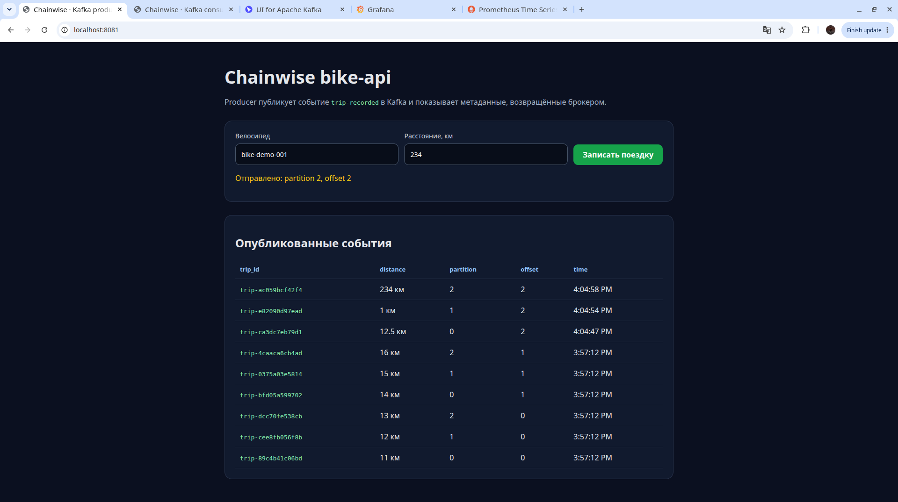

`maintenance-worker` (consumer) подключается к группе `maintenance-workers`. После чтения
события он имитирует расчёт обслуживания, сохраняет имя своего экземпляра,
partition и offset, затем фиксирует offset группы. Адрес Kafka, имя топика,
consumer group и имя экземпляра передаются через переменные окружения. Для обоих
сервисов подготовлены отдельные Dockerfile.

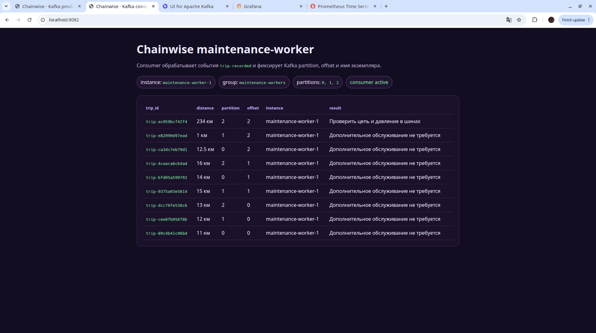

## Часть 2. Запуск Kafka и сервисов

Стенд описан в `docker-compose.yml`. Kafka 4.3.1 работает в режиме KRaft с
совмещёнными ролями broker и controller, ZooKeeper не используется. Для
локального стенда задан один broker и replication factor 1.

Топик создаётся контейнером `topic-controller` через Kafka Admin API. Его имя,
число партиций, retention и длительность сегмента берутся из `.env`. Ручные
команды `kafka-topics.sh` не применялись.

Тестовое событие для `bike-demo-001` с расстоянием 11 км было записано в
partition 0 с offset 0. Первый worker получил партиции 0, 1 и 2 и обработал это
событие (см. Ч.1).

## Часть 3. Проверка бизнес-сценариев

### 3.1. Подготовка к росту нагрузки и возврат конфигурации

До изменения топик `trip-recorded` содержал три партиции. Такое число ограничивало
полезный параллелизм тремя consumer-ами одной группы. Для подготовки к росту
потока в `.env` значение `KAFKA_PARTITIONS` было изменено с 3 на 6, и был добавлен еще один worker.

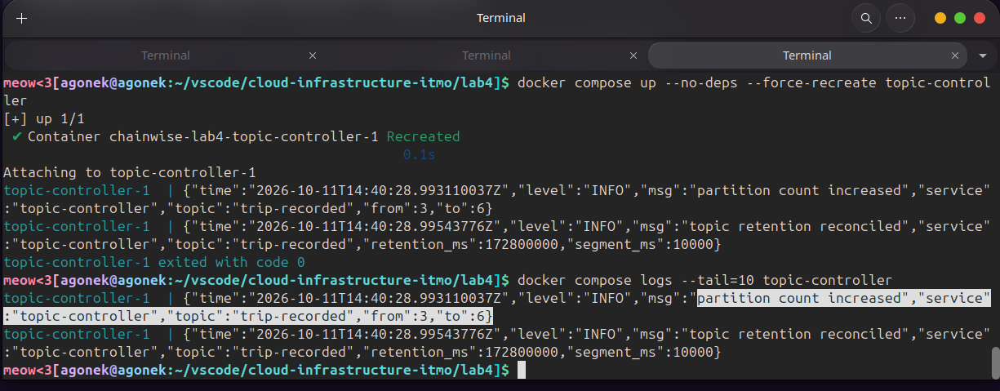

После запуска четырёх worker-ов Kafka выполнила rebalance. В Kafka UI
отобразились четыре участника группы и шесть назначенных партиций.

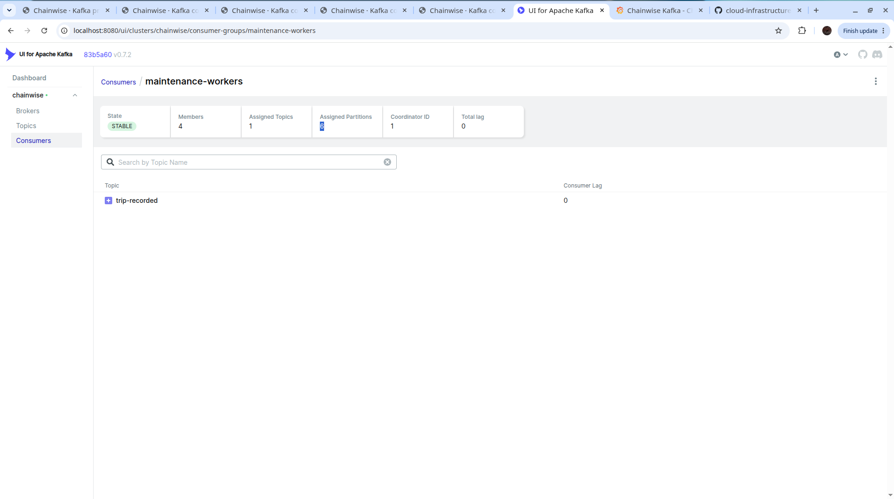

Сначала было проверено само назначение новой партиции. Ранее простаивавший
`maintenance-worker-4` получил partition 3.

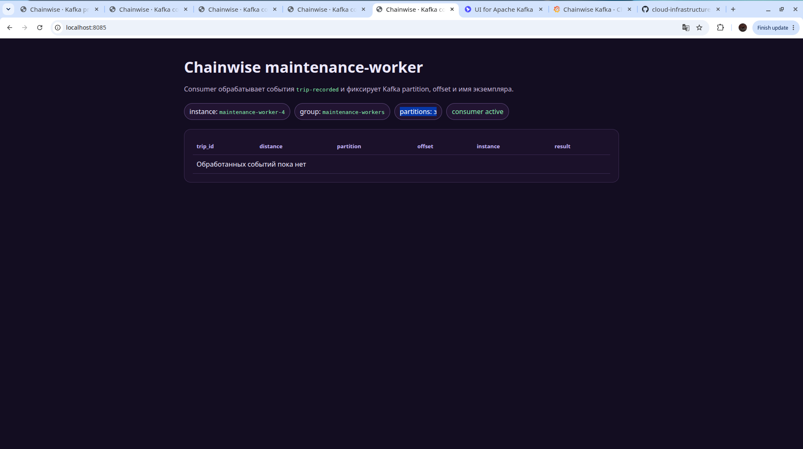

Затем были опубликованы тестовые события с расстоянием 25 км. На странице
`maintenance-worker-1` видны обработанные сообщения из partitions 0 и 4, а на
странице `maintenance-worker-4` видны сообщения из partition 3. Это подтверждает,
что после увеличения топика события действительно обрабатывались несколькими
экземплярами параллельно.

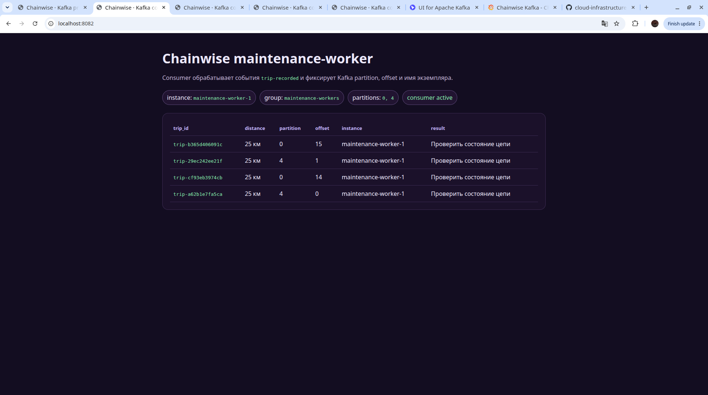

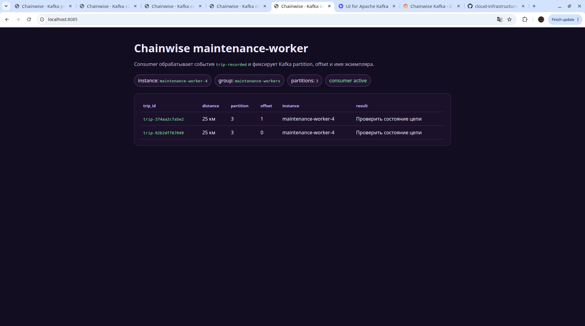

После проверки в конфигурацию было возвращено значение
`KAFKA_PARTITIONS=3`, и `topic-controller` был применён ещё раз. Контроллер
вывел предупреждение и оставил фактическое число партиций равным 6.

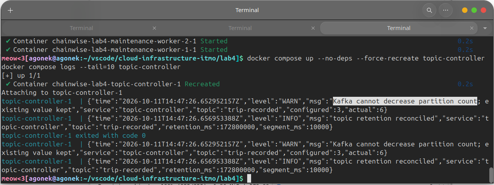

Kafka не позволяет уменьшать число партиций существующего топика. После такого
изменения нельзя было бы однозначно сохранить прежнее распределение ключей и
порядок сообщений внутри партиций.

### 3.2. Второй worker и ограничение числа consumer-ов

Для отдельной проверки в группе `maintenance-workers` были оставлены два
экземпляра. После rebalance `maintenance-worker-1` получил partitions 0, 2 и 4,
а `maintenance-worker-2` получил partitions 1, 3 и 5. После публикации тестовых
событий оба worker-а показали обработанные сообщения на своих страницах.

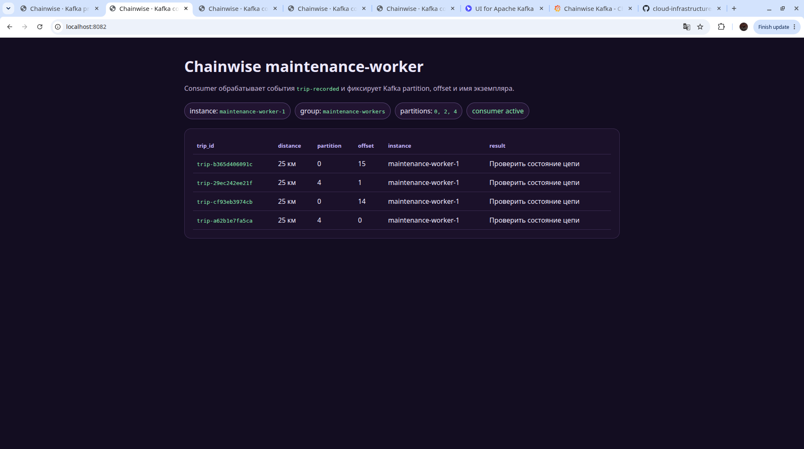

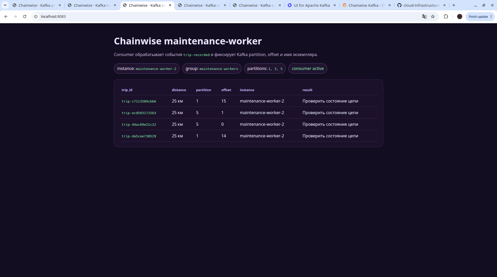

Эта проверка показывает назначение партиций внутри consumer group: одну
партицию в каждый момент читает только один участник группы, поэтому одно
сообщение не обрабатывается обоими worker-ами одновременно.

Ситуация, когда экземпляров больше, чем доступных партиций, была проверена до
увеличения топика. При трёх партициях были запущены четыре worker-а. Первые три
получили по одной партиции, а у `maintenance-worker-4` список назначений остался
пустым.

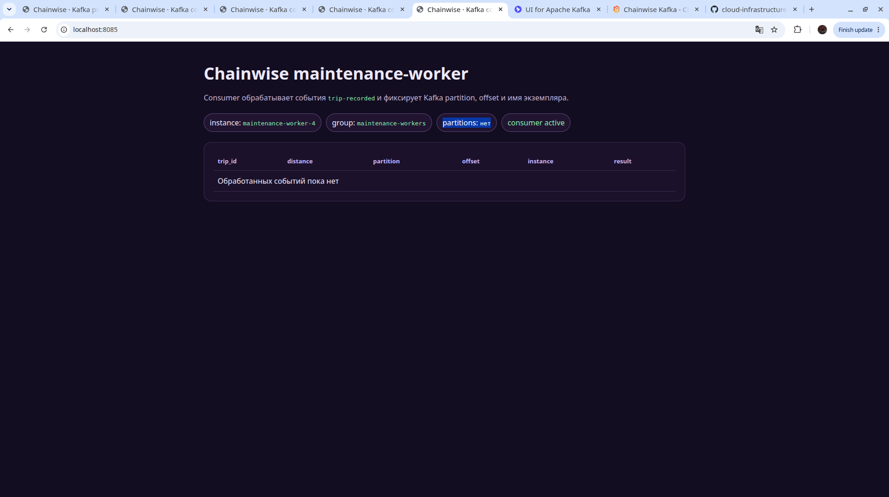

Таким образом, число одновременно работающих consumer-ов одной группы
ограничено числом партиций. Лишний экземпляр остаётся участником группы, но не
получает сообщения до следующего rebalance или появления дополнительных
партиций.

### 3.3. Остановка worker-ов во время деплоя

Для воспроизведения сбоя были остановлены все четыре экземпляра
`maintenance-worker`. После этого через `bike-api` были опубликованы шесть новых
поездок. Producer успешно получил от Kafka partition и offset для каждой записи,
хотя работающих обработчиков в этот момент не было.

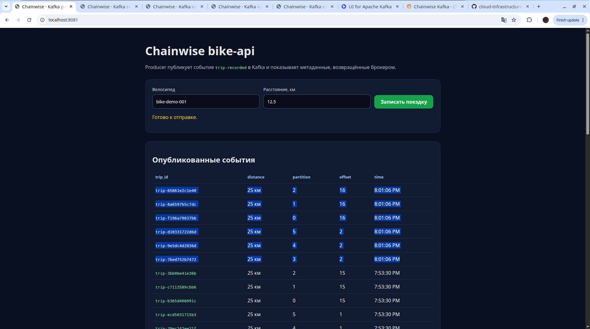

В Kafka UI группа `maintenance-workers` перешла в состояние `EMPTY`, число
участников стало равным 0, а суммарный lag вырос до 6. Это подтверждает, что
сообщения сохранились в Kafka и ожидали обработки.

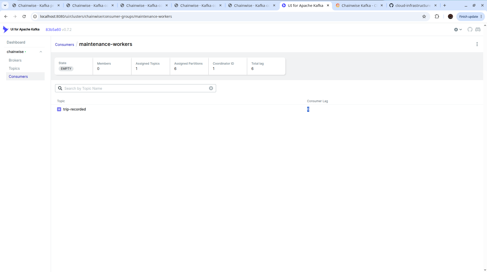

После запуска `maintenance-worker-1` ему были назначены все шесть партиций. На
его странице появились те же `trip_id`, которые ранее были показаны на странице
`bike-api`. Следовательно, события, опубликованные во время остановки, не были
потеряны и обработались после восстановления consumer-а.

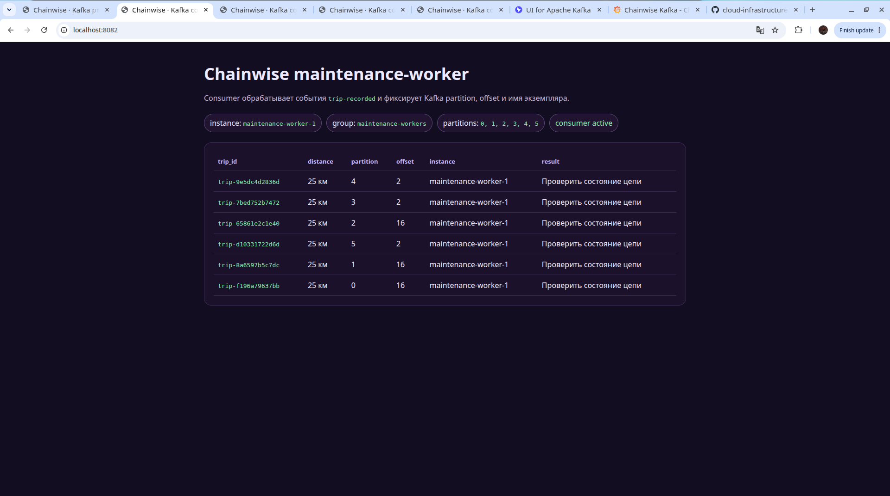

После завершения обработки Kafka UI показал одного активного участника и
нулевой lag.

Producer записывает событие непосредственно в Kafka broker, поэтому наличие
активного consumer-а для публикации не требуется. Consumer group хранит
подтверждённые offsets, а после запуска worker продолжает чтение с сохранённой
позиции и получает все накопившиеся сообщения.

## Часть 4. Kafka UI

Kafka UI доступен на порту 8080 и подключён к broker-у по внутреннему адресу
`kafka:29092`. В интерфейсе отображаются топик `trip-recorded`, его партиции,
сообщения и группа `maintenance-workers`.

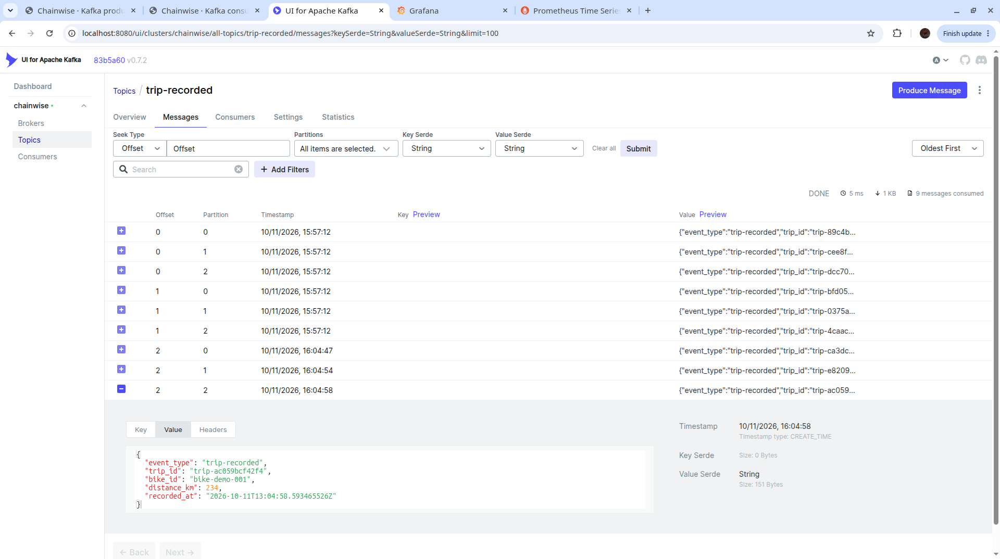

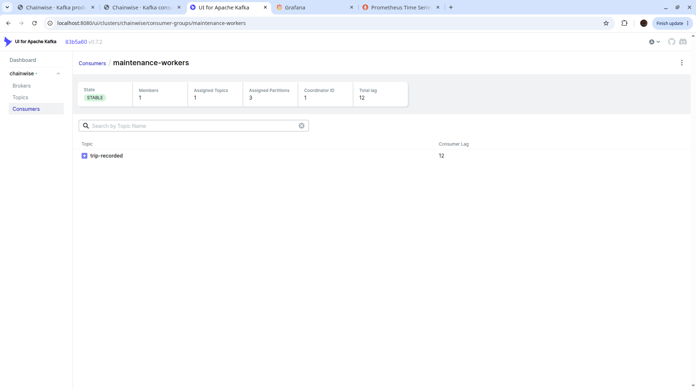

(во время выполнения прошлого задания накопился lag, тода и был сделан скриншот, вне этого все работает штатно и lag равен нулю)

## Часть 5. Операции через Kafka UI

### 5.1. Разбор жалобы на конкретную поездку

Для проверки было выбрано событие `trip-65861e2c1e40` со страницы `bike-api`.
Producer показал, что событие было опубликовано в partition 2 с offset 16.

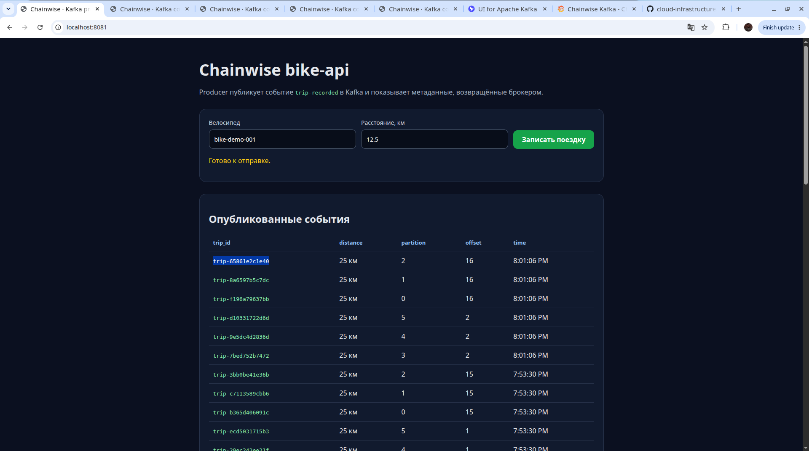

На вкладке Messages топика `trip-recorded` была найдена запись с тем же
`trip_id`.

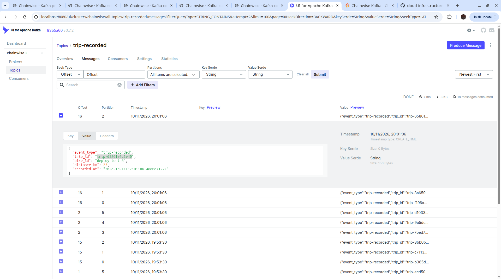

После этого была открыта группа `maintenance-workers`. Kafka UI показал одного
активного участника, шесть назначенных партиций и `Total lag = 0`.

Нулевой общий lag означает, что у группы нет непрочитанных сообщений ни в одной
из шести партиций. Следовательно, сообщение из partition 2 с offset 16 уже было
прочитано и подтверждено worker-ом.

### 5.2. Повторная обработка истории

Для воспроизведения пересчёта истории все worker-ы были остановлены. В Kafka UI
для группы `maintenance-workers` были выбраны все партиции топика
`trip-recorded`, и их offsets были сброшены в начало (тип ресета`earliest`).

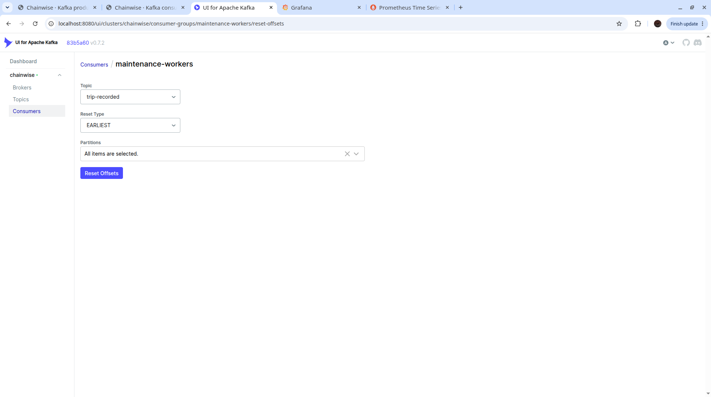

После запуска `maintenance-worker-1` его страница сначала была пустой. Затем на
ней последовательно появились ранее обработанные события.

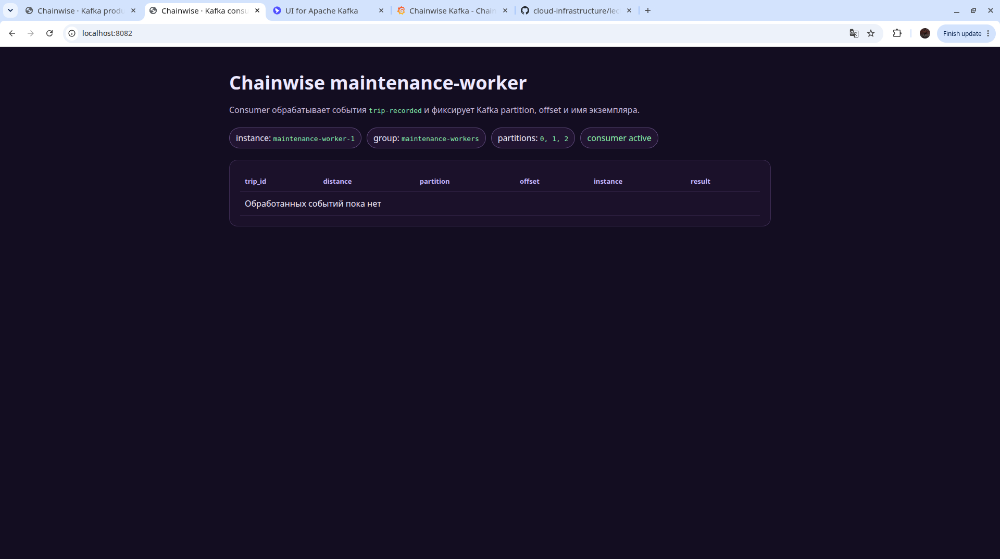

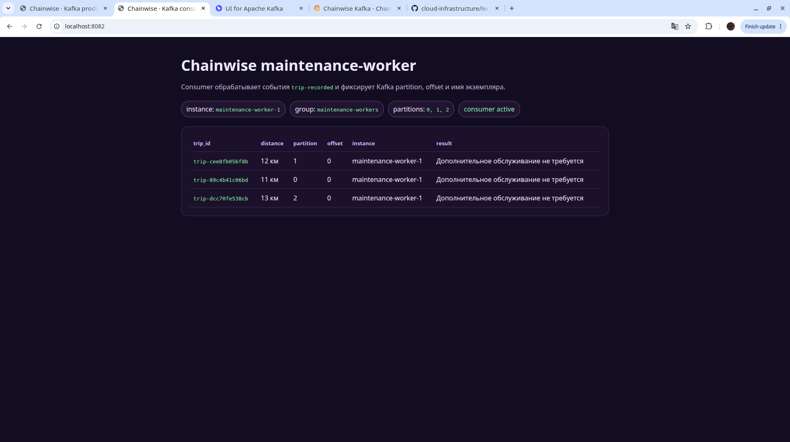

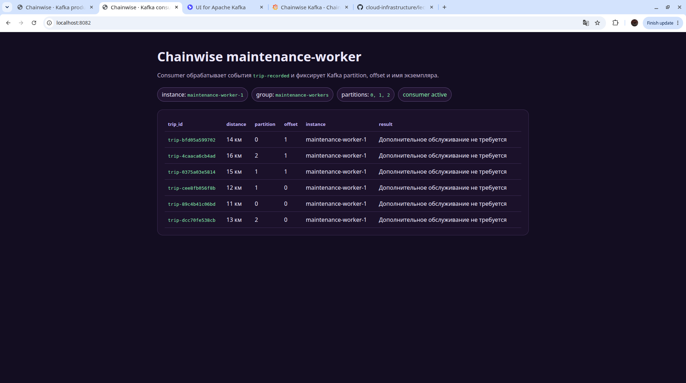

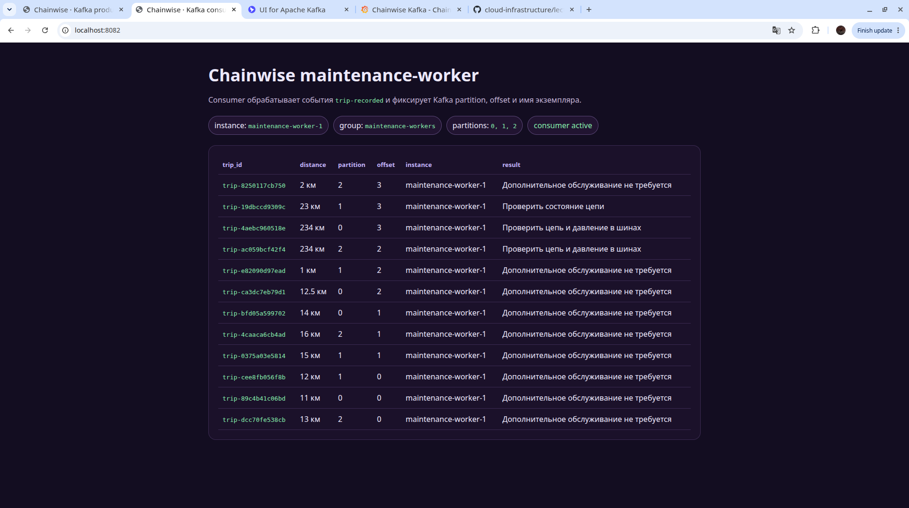

Kafka хранит сообщения отдельно от offsets каждой consumer group. Операция
reset изменила позицию следующего чтения, но не удалила и не создала сообщения
повторно, поэтому worker смог перечитать историю с начала. В обычной очереди
подтверждённое сообщение обычно удаляется, поэтому такой повторный запуск без
отдельного хранилища невозможен.

### 5.3. Удаление сообщений по retention

Для выполненияэтой части были установлены
`KAFKA_RETENTION_MS=15000` и `KAFKA_SEGMENT_MS=5000`. Сначала в Kafka UI отображались сообщения с offsets 8,
9 и 10.

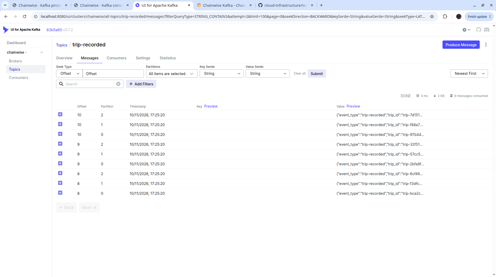

Затем пришли новые сообщения с offsets 11, 12 и 13, а прошлые сообщения удалились из-за короткого retention, хоть уже и были прочитаны.

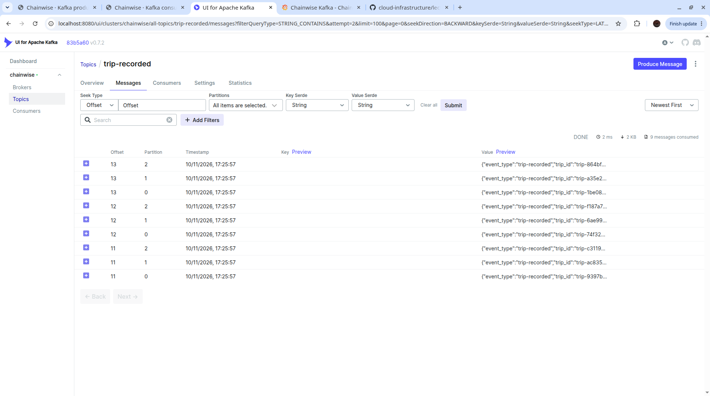

После истечения retention во второй раз вкладка Messages стала
пустой, так как все сообщения удалились.

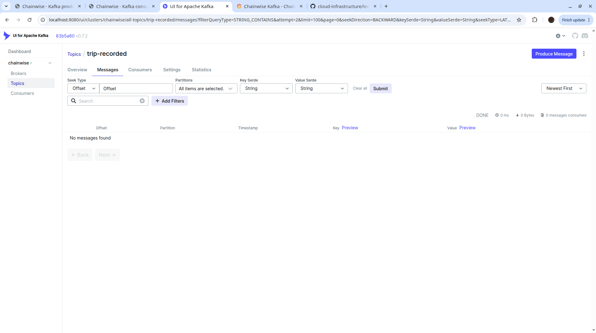

## Часть 6. Мониторинг

Метрики Kafka собираются через `kafka_exporter`, прикладные метрики producer-а и
consumer-а публикуются самими сервисами. Prometheus опрашивает все источники раз
в пять секунд. В Grafana автоматически создаётся дашборд `Chainwise Kafka` со
следующими показателями: число broker-ов и партиций, количество участников
группы, общий lag, lag по партициям, текущие offsets, скорость публикации и
обработки событий.

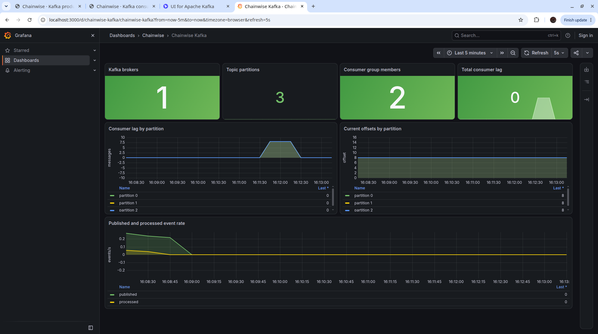

Для алертов выбраны три метрики.

| Alert | Условие | Причина выбора |
| --- | --- | --- |
| `KafkaBrokerUnavailable` | `max(kafka_brokers) < 1` в течение 15 секунд | При отсутствии broker-а producer не может записывать новые поездки, а consumer не может получать события |
| `MaintenanceConsumerMissing` | В `maintenance-workers` нет участников 30 секунд | События сохраняются в Kafka, но расчёт обслуживания не выполняется и результат устаревает |
| `KafkaConsumerLagHigh` | Суммарный lag больше 5 сообщений 30 секунд | Рост очереди показывает, что worker-ы не успевают за producer-ом или остановились |
