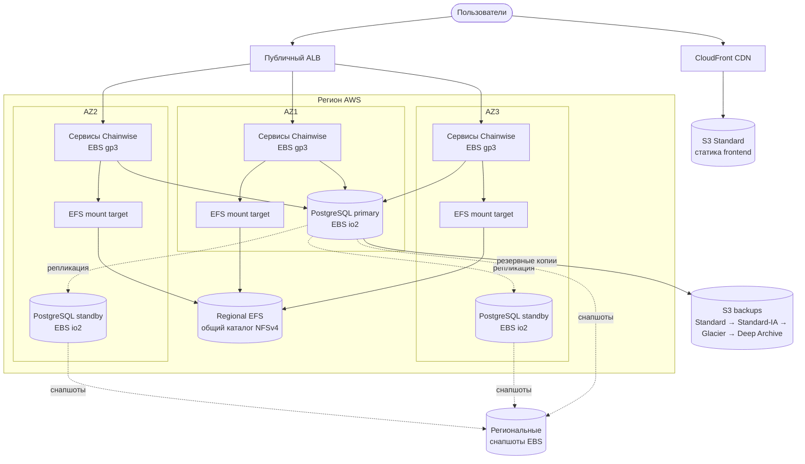

# Лабораторная работа №5. Хранилища данных для Chainwise

В работе спроектировано хранение данных для сервиса Chainwise, который помогает
велосипедистам учитывать поездки, следить за состоянием велосипеда и получать
напоминания о техническом обслуживании. Сетевая архитектура остается такой же,
как в первой лабораторной. Приложение работает в трех зонах доступности, сервисы
находятся в private подсетях, а PostgreSQL размещен в отдельных data подсетях.

## Этап 1. Сравнение типов хранилищ

### 1.1. Сравнительная таблица трех сервисов

| Параметр | EBS (Block) в Chainwise | EFS (File) в Chainwise | S3 (Object) в Chainwise |
| --- | --- | --- | --- |
| Уровень | Низкий, блоки системных дисков и PostgreSQL | Средний, файлы общего каталога | Высокий, объекты статики и резервных копий |
| Единица данных | Блок тома gp3 или io2 | Файл в общем каталоге Chainwise | Объект с ключом и метаданными в отдельном бакете |
| Потребителей | Один экземпляр сервиса или узел PostgreSQL на каждый том | Экземпляры Chainwise в трех зонах одновременно | Пользователи через CloudFront, CI и процессы резервного копирования через API |
| Протокол | NVMe для подключения тома к EC2 | NFSv4 для монтирования общего каталога | HTTPS и S3 API |
| Масштабирование | Размер и производительность каждого тома меняются отдельно | Емкость Regional EFS растет автоматически | Бакеты статики и бэкапов масштабируются без управления томами |
| Стоимость на ГБ | Высокая, поэтому io2 используется только для PostgreSQL | Средняя и оправдана только для общего каталога | Низкая, а старые копии переходят в более дешевые классы |
| Задержка | Минимальная и предсказуемая для дисковых операций | Около 10 мс, что допустимо для общих файлов | Мгновенная для Standard и Standard-IA, у Glacier требуется восстановление |
| Резерв | Региональные снапшоты gp3 и io2 | Regional EFS хранит данные в нескольких зонах | S3 хранит объекты между зонами региона, дополнительно включено версионирование |

От Block к Object уменьшается стоимость хранения и становится проще наращивать
объем, но при этом пропадает доступ к отдельным блокам с минимальной задержкой.
Block подходит для операций, где важны IOPS и предсказуемое время ответа, File
удобен для совместной работы нескольких серверов, а Object выгоднее всего для
больших объемов данных, которые читаются как целые объекты.

### 1.2. Назначение хранилищ для Chainwise

| Сервис заказчика | Тип хранилища | Сервис (AWS) | Класс / тип | Обоснование |
| --- | --- | --- | --- | --- |
| Веб-фронтенд Chainwise и его статика | Object | S3 и CloudFront | S3 Standard | HTML, CSS, JavaScript и изображения раздаются через CDN, а S3 подходит для чтения готовых объектов |
| Виртуальные машины с сервисами Chainwise | Block | EBS | gp3 | `frontend`, `bike-api` и внутренним API нужен быстрый системный SSD диск без дорогих гарантированных IOPS |
| PostgreSQL | Block | EBS | io2 | Для базы важны случайные операции и предсказуемая задержка под нагрузкой |
| Общий каталог сервисов Chainwise | File | EFS | Regional и General Purpose | Экземпляры в трех зонах должны одновременно видеть одни и те же файлы по NFS |
| Резервные копии PostgreSQL и архив | Object | S3 | Standard, Standard-IA, Glacier и Deep Archive | Класс автоматически меняется по возрасту объекта и уменьшает стоимость хранения |

В этой схеме база не помещается в S3, потому что PostgreSQL нужен случайный
доступ к блокам и файловая система. Общий каталог не размещается на одном EBS,
потому что он должен быть доступен экземплярам сразу в трех зонах. S3
используется там, где приложение работает с готовыми объектами, а не с блоками
диска.

### 1.3. Аналоги у других провайдеров

| Роль в Chainwise и сервис AWS | Yandex Cloud | VK Cloud | Azure | Google Cloud |
| --- | --- | --- | --- | --- |
| Системные диски gp3 и тома PostgreSQL io2 на EBS | Compute Disks | Volumes | Managed Disks | Persistent Disk |
| Общий каталог сервисов на EFS | Filestorage | File storage | Azure Files | Filestore |
| Статика и резервные копии в S3 | Object Storage | Cloud Storage | Blob Storage | Cloud Storage (GCS) |

Названия у провайдеров отличаются, но назначение остается тем же. Диски дают
блочный доступ виртуальным машинам, файловые сервисы предоставляют общий каталог,
а объектные сервисы хранят данные по ключам и отдают их через API.

## Этап 2. Использование сервисов AWS

### 2.1. Диски виртуальных машин и PostgreSQL

Для корневых дисков `frontend`, `bike-api`, `maintenance-api`, `weather-api`,
`reminder-api` и `user-api` выбран EBS gp3. Это основной SSD вариант для обычных
нагрузок, в котором размер, IOPS и пропускную способность можно настраивать
отдельно. Платить за io2 для системного диска каждого экземпляра нет смысла,
потому что прикладные сервисы не выполняют постоянный поток критичных дисковых
операций.

У каждого узла PostgreSQL будет отдельный том EBS io2. База выполняет много
случайных чтений и записей, поэтому для нее важны заранее заданные IOPS и
стабильная задержка. gp3 можно было бы использовать для небольшой тестовой базы,
но в условии указана высокая нагрузка, поэтому для основной базы выбран io2.

Типы io1 и io2 нужны базам и другим критичным системам с заданным числом IOPS,
при этом io2 является более новым вариантом. gp3 подходит большинству обычных
SSD нагрузок. st1 рассчитан на последовательное чтение больших объемов с HDD, а
sc1 используют для редко читаемых данных, когда цена важнее скорости. Для
системных дисков и PostgreSQL в Chainwise типы st1 и sc1 не подходят.

### 2.2. Снапшоты EBS

Сам том EBS относится к одной зоне доступности. Для каждого тома настраиваются
автоматические инкрементальные снапшоты, а перед снимком базы выполняется
контрольная точка PostgreSQL, чтобы на диске оказалось согласованное состояние.

Для томов PostgreSQL выбран следующий график хранения.

| Периодичность | Срок хранения | Назначение |
| --- | --- | --- |
| Каждые 6 часов | 7 дней | Восстановление после недавней ошибки или повреждения данных |
| Один снимок в сутки | 30 дней | Восстановление состояния за нужный день |
| Один снимок в месяц | 12 месяцев | Более длительное аварийное хранение |

Для системных дисков API достаточно одного ежедневного снапшота с хранением 7
дней и одного еженедельного с хранением 4 недели, потому что сами сервисы можно
повторно развернуть из образа и репозитория.

Снапшот EBS является региональным ресурсом. Его данные реплицируются между
зонами региона, поэтому из снимка можно создать новый том в любой зоне этого же
региона. Если узел базы в одной зоне станет недоступен, снимок не останется
привязан к отказавшей зоне. Региональный снапшот дополняет репликацию PostgreSQL,
но не заменяет ее, потому что между снимками все равно остается интервал.

### 2.3. Статика и CDN

Файлы frontend собираются в отдельный закрытый бакет
`chainwise-frontend-assets`. CloudFront получает объекты из этого бакета и
остается единственной публичной точкой чтения. Прямой публичный доступ к бакету
не включается. HTML получает небольшой срок кэширования, а файлы JavaScript,
CSS, шрифты и изображения публикуются с хешем содержимого в имени и долгим
сроком кэширования.

Версионирование бакета сохраняет предыдущие варианты файлов после новой сборки.
Текущая версия остается в S3 Standard. Неактуальные версии через 30 дней
переходят в Standard-IA, через 90 дней в Glacier Flexible Retrieval, а через 365
дней удаляются. Такой срок оставляет возможность откатить несколько предыдущих
релизов, но не заставляет постоянно платить за их хранение в горячем классе.

### 2.4. Общий каталог

Для общего каталога выбран Regional EFS в режиме General Purpose. В каждой из
трех private подсетей создается mount target. Экземпляр обращается к DNS имени
EFS, которое приводит его к точке монтирования в той же зоне, и подключает
файловую систему по NFSv4, например в каталог `/mnt/chainwise-shared`.

Один и тот же каталог одновременно монтируют экземпляры сервисов во всех трех
зонах, поэтому новый файл сразу доступен остальным серверам. Security Group EFS
разрешает TCP порт 2049 только от Security Groups прикладных сервисов. Публичного
доступа у файловой системы нет.

### 2.5. Резервные копии и архив

Резервные копии PostgreSQL, экспорт истории поездок и старые служебные данные
попадают в закрытый бакет `chainwise-backups`. Сразу после загрузки объект
хранится в S3 Standard, чтобы недавнюю копию можно было быстро получить. Через
30 дней он автоматически переходит в Standard-IA, через 90 дней в Glacier
Flexible Retrieval, а через 365 дней в Glacier Deep Archive. Удаление архивов
происходит только после установленного срока хранения, например через 7 лет.

Такой переход уменьшает стоимость по мере того, как вероятность чтения копии
становится ниже. Для Standard-IA и архивных классов учитываются минимальный срок
хранения и отдельная плата за получение данных, поэтому часто перемещать между
ними новые объекты не нужно.

## Этап 3. Классы S3 и жизненный цикл

### 3.1. Классы хранения

| Класс | Назначение в Chainwise | Скорость доступа | Стоимость |
| --- | --- | --- | --- |
| S3 Standard | Текущая статика frontend и резервные копии младше 30 дней | Мгновенная | Самая высокая |
| S3 Intelligent-Tiering | Экспорты Chainwise с заранее неизвестной частотой чтения, для основного правила бэкапов не используется | Мгновенная | Средняя и меняется вместе с уровнем |
| S3 Standard-IA | Копии возрастом от 30 до 90 дней и старые версии статики | Мгновенная, но чтение оплачивается отдельно | Ниже Standard |
| S3 Glacier | Копии возрастом от 90 до 365 дней | От нескольких минут в зависимости от режима восстановления | Низкая |
| S3 Glacier Deep Archive | Копии старше 365 дней, которые хранятся до 7 лет | До 12 часов при стандартном восстановлении | Минимальная |

Intelligent-Tiering полезен тогда, когда заранее неизвестно, как часто будут
читать объект. Для резервных копий Chainwise возраст данных известен, поэтому
понятное правило с Standard-IA и Glacier проще и не требует оплаты наблюдения за
каждым небольшим объектом.

### 3.2. Правила жизненного цикла

Для бакета резервных копий используется следующее правило.

1. Новая резервная копия записывается в S3 Standard.
2. Через 30 дней она переходит в S3 Standard-IA.
3. Через 90 дней она переходит в S3 Glacier Flexible Retrieval.
4. Через 365 дней она переходит в S3 Glacier Deep Archive.
5. Через 7 лет объект и его старые версии удаляются по принятому сроку хранения.

Экономия появляется потому, что дорогой мгновенный доступ оплачивается только
для свежих копий. Старые данные читаются редко, поэтому более долгая процедура
восстановления приемлема, а основная плата за их хранение становится меньше.

Для бакета статики правило применяется только к неактуальным версиям объектов.
Текущая версия остается в Standard, а предыдущие версии через 30 дней переходят
в Standard-IA, через 90 дней в Glacier Flexible Retrieval и через 365 дней
удаляются.

### 3.3. S3 Select и Glacier Select

S3 Select выполняет ограниченный SQL запрос внутри одного объекта в формате
CSV, JSON или Parquet и возвращает только подходящие строки и столбцы. Клиенту
не приходится скачивать весь большой файл, поэтому уменьшаются объем передачи и
время обработки.

Glacier Select решает похожую задачу для архивного объекта. Запрос выполняется
как часть операции восстановления, а результат записывается в указанный бакет.
Это удобно, если из большого архива нужен небольшой фрагмент, например поездки
одного велосипеда за выбранный период.

На момент выполнения работы AWS больше не предоставляет S3 Select новым
клиентам, но существующие клиенты могут продолжать им пользоваться. В задании
этот механизм рассматривается как способ фильтрации данных внутри объекта. Для
новой системы похожие запросы можно выполнять через Amazon Athena.

### 3.4. Версионирование резервных копий

Для `chainwise-backups` включено версионирование. Если объект перезаписали, его
предыдущая версия остается доступна, а обычное удаление создает маркер удаления,
не уничтожая старые версии сразу. Это защищает от случайной перезаписи и
удаления, если ошибка обнаружена до завершения срока хранения старых версий.

Одного версионирования недостаточно против пользователя, который имеет право
удалять версии окончательно, поэтому прикладные роли не получают такого права.
Для старых версий также действует жизненный цикл, иначе они будут накапливаться
без ограничения.

## Этап 4. Архитектура и резервирование

### 4.1. Схема хранения

Исходный файл схемы находится в `scheme/storage.mmd`.

### 4.2. Чек-лист выбора хранилища

| Данные | Число потребителей | Допустимая задержка | Характер доступа | Объем и класс | Резервирование и жизненный цикл | Решение по стоимости |
| --- | --- | --- | --- | --- | --- | --- |
| Системные диски API | Один экземпляр на том | Миллисекунды | Случайное чтение и запись | Небольшой или средний объем на gp3 | Ежедневные и еженедельные снапшоты | gp3 дешевле io2 и достаточен для приложения |
| Данные PostgreSQL | Один узел базы на том | Минимальная и предсказуемая | Много случайных операций | Рабочий набор на io2 | Реплики в трех зонах, снапшоты и резервные копии | io2 дороже, но оправдан требованиями к IOPS |
| Общий каталог | Несколько серверов в трех зонах | Сетевая файловая задержка допустима | Работа с файлами и каталогами | EFS Regional | Данные хранятся в нескольких зонах | EFS оплачивается только там, где действительно нужен общий доступ |
| Статика frontend | Много пользователей через CDN | Мгновенная выдача активных файлов | Чтение целых объектов | Standard для текущих версий | Версии и переход старых файлов в холодные классы | CDN уменьшает обращения к S3, старые версии дешевеют |
| Резервные копии и архив | Несколько служебных процессов, чтение бывает редко | Для старых копий допустимы часы | Запись и получение целых объектов | От Standard до Deep Archive | Версионирование и жизненный цикл до 7 лет | Холодные классы уменьшают цену многолетнего хранения |

Для каждого набора данных проверены все шесть вопросов из лекции. Учтено число
потребителей, допустимая задержка, случайный или последовательный доступ, объем
и класс, требования к копиям и жизненному циклу, а также оправданная стоимость
одного гигабайта.

### 4.3. Отказоустойчивость

Тома EBS остаются зональными, поэтому один том не используется как единственная
копия базы. PostgreSQL имеет primary и два standby узла в разных зонах, причем у
каждого узла свой io2. Региональные снапшоты EBS позволяют создать новый том в
любой зоне того же региона.

Выбран Regional EFS, который хранит данные и метаданные между несколькими
зонами. В VPC создается по одному mount target в каждой из трех зон, поэтому
экземпляры штатно обращаются к локальной точке монтирования и не зависят от
одного сетевого адреса в другой зоне.

S3 Standard, Standard-IA и выбранные классы Glacier хранят данные на нескольких
устройствах как минимум в трех зонах одного региона. Эту репликацию выполняет
сам сервис S3. Версионирование и жизненный цикл дополняют зональное
резервирование, потому что копии между зонами сами по себе не защищают от
логического удаления объекта пользователем.

## Этап 5. Выводы

В этой работе стало понятнее, почему один тип хранилища нельзя использовать для
всех данных. Для PostgreSQL нужен блочный том с предсказуемыми IOPS, сервисам
достаточно обычных gp3, общий каталог удобнее хранить в EFS, а статику и
резервные копии в S3. Если бы база находилась в объектном хранилище, она не
получила бы нужный доступ к блокам, а один общий EBS для нескольких серверов
создал бы проблему совместного доступа.

Также был составлен жизненный цикл для двух бакетов. Активные файлы остаются в
Standard, а старые версии и резервные копии переходят в более дешевые классы.
Версионирование защищает от обычной перезаписи и удаления, снапшоты EBS позволяют
восстановить том в другой зоне, а Regional EFS и S3 не зависят от одной зоны
доступности.

Работа была проектной и реальные облачные ресурсы не создавались, поэтому после
ее завершения удалять ресурсы у провайдера не потребовалось.

## Контрольные вопросы

### 1. Кто создает файловую систему поверх блочного диска

Облачное хранилище отдает операционной системе набор блоков, похожий на обычный
диск. Файловую систему поверх него создает и обслуживает ОС. В Linux это может
быть ext4 или XFS, а в Windows NTFS или ReFS.

### 2. Почему один блочный диск нельзя использовать как обычный общий диск нескольких виртуальных машин

Блочное хранилище не управляет файлами и не координирует кэш и одновременную
запись разных операционных систем. Если несколько обычных файловых систем начнут
менять одни блоки, метаданные могут повредиться. EFS само предоставляет общую
файловую систему через NFS и согласует доступ нескольких клиентов.

### 3. Где хранится снапшот EBS

Снапшот EBS хранится как региональный ресурс, а его данные реплицируются между
зонами региона. Из него можно восстановить новый том в любой зоне того же
региона.

### 4. Какие классы S3 идут от горячего к холодному

В порядке, который используется в задании, идут S3 Standard,
S3 Intelligent-Tiering, S3 Standard-IA, S3 Glacier Flexible Retrieval и
S3 Glacier Deep Archive. Intelligent-Tiering отдельно перемещает данные между
своими уровнями в зависимости от обращений.

### 5. Чем помогают S3 Select и Glacier Select

Они выполняют SQL фильтрацию внутри одного объекта и возвращают только нужную
часть данных. Благодаря этому клиент не скачивает целый большой файл, если ему
нужны несколько строк или столбцов.

### 6. Какие аналоги есть в Yandex Cloud и VK Cloud

В Yandex Cloud аналогами являются Network Disks, File storages и Object Storage.
В VK Cloud им соответствуют Volumes, File storage и Cloud Storage с S3 API.

### 7. Как выбрать тип хранилища одной фразой

Блочное хранилище выбирается для скорости, файловое для общего каталога, а
объектное для большого объема и недорогого хранения.
