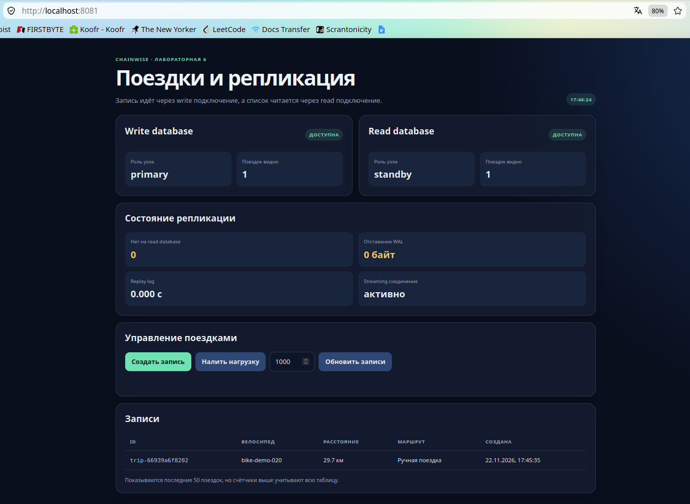
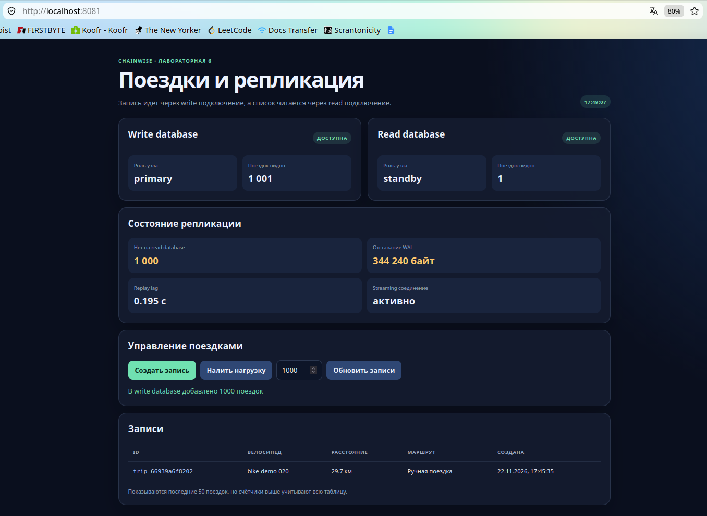
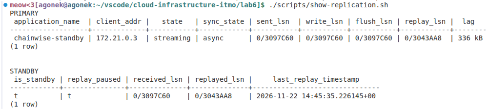
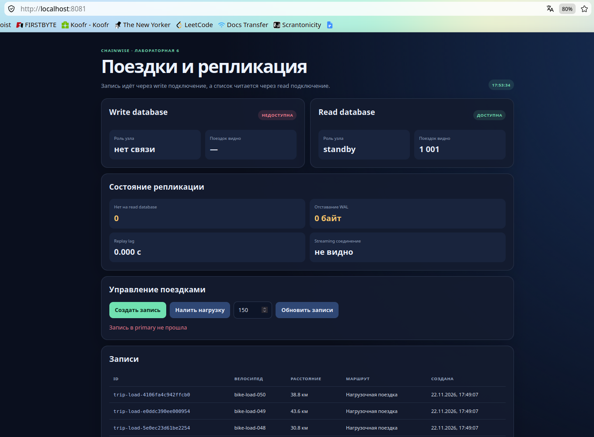
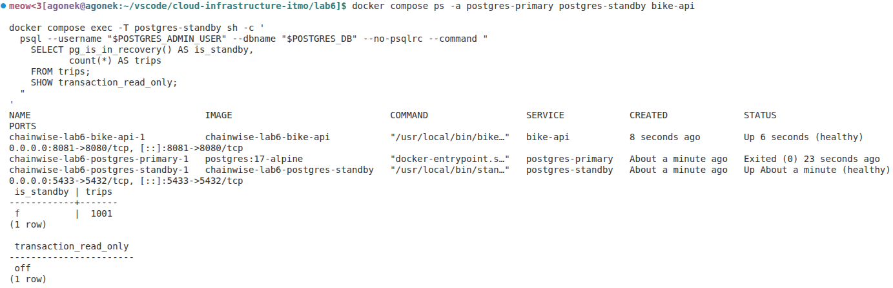
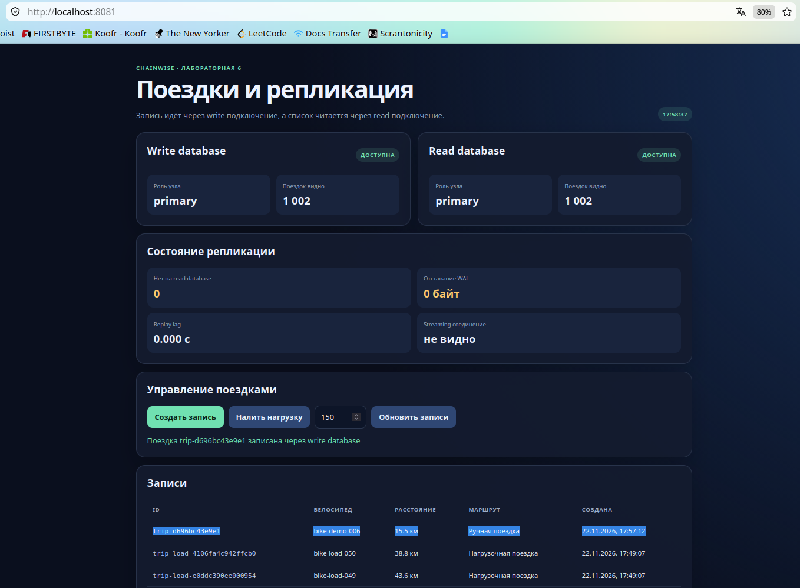
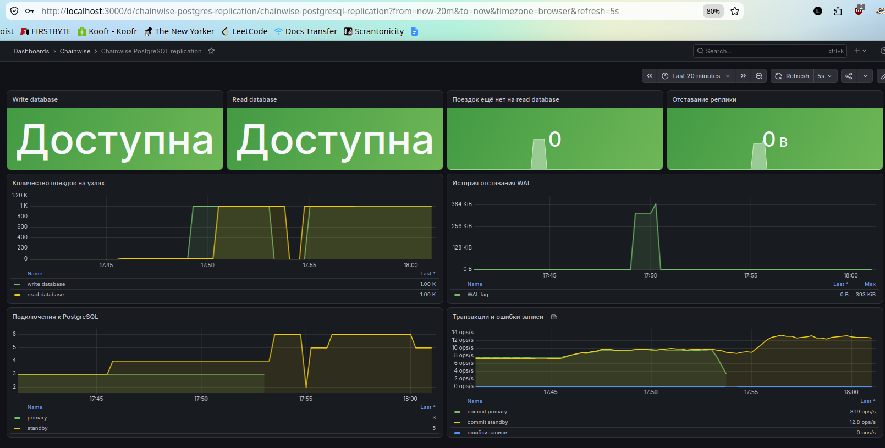
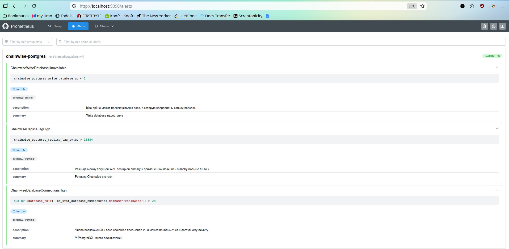

# Лабораторная работа №6. Репликация PostgreSQL в Chainwise

В этой работе для базы данных Chainwise была настроена потоковая репликация,
разделены подключения для чтения и записи, проверено отставание standby и
выполнен ручной failover.

## Часть 0. Выбор СУБД

Для Chainwise я выбрала PostgreSQL, потому что эта база уже была заложена в
архитектуре проекта для хранения пользователей, велосипедов, поездок и истории
обслуживания. Данные связаны между собой, поэтому реляционная модель подходит
для них лучше и добавлять в проект вторую СУБД только ради этой работы не было
смысла.

В варианте с PostgreSQL репликация настраивается через primary и standby, а
переключение при отказе выполняется вручную. Поэтому в этой работе можно было
отдельно проверить настройку streaming replication, поведение асинхронной
реплики и повышение standby без встроенных автоматических выборов MongoDB.

## Часть 1. Репликация через конфигурацию

Стенд описан в `docker-compose.yml`. Primary запускается с
`wal_level=replica` и использует физический слот `chainwise_standby_slot`.
Standby при первом запуске получает базовую копию через `pg_basebackup`, создаёт
`standby.signal` и подключается к primary с именем `chainwise-standby`.

## Часть 2. Сервис с read/write splitting

В работе использовался уже существующий сервис `bike-api` из архитектуры
Chainwise, который применялся в предыдущих лабораторных и запускается из своего
Dockerfile. Для этого стенда его подключение к PostgreSQL было разделено через
`WRITE_DB_HOST` и `READ_DB_HOST`. Создание одной записи и нагрузка идут в
primary, а список поездок читается со standby. На странице остались привычные
действия с поездками, включая создание одной записи, добавление нагрузки и
обновление списка.

После создания первой поездки write база показывала роль `primary`, read база
показывала роль `standby`, а на обоих узлах была видна одна строка. На странице
также отображалось активное streaming соединение и нулевое отставание.

## Часть 3. Replication lag

При обычной работе standby успевала применять изменения почти сразу. Чтобы
увидеть отставание, я временно остановила применение WAL через
`pg_wal_replay_pause()` и добавила ещё 1000 поездок.

Primary подтвердил запись, не дожидаясь применения изменений на асинхронной
реплике. Write подключение уже видело `1001` строку, а read подключение всё ещё
видело одну. На странице отображались `1000` отсутствующих на read базе записей,
WAL lag был равен `344240` байтам, а replay lag составлял около `0.195` секунды.

Соединение при этом осталось в состоянии `streaming`. Standby получила WAL до
позиции `0/3097C60`, но применила его только до `0/3043AA8`, поэтому разница
составляла около `336 KiB`. В консоли также было видно, что применение WAL
действительно остановлено.

Размер отставания в PostgreSQL можно измерять функцией
`pg_wal_lsn_diff(pg_current_wal_lsn(), replay_lsn)`, которая возвращает число
ещё не применённых байтов WAL. Отставание по времени можно смотреть в
`replay_lag`.

Для Chainwise такой lag означает, что пользователь может создать поездку и
сразу не увидеть её в списке, а расчёт пробега некоторое время будет работать
со старым значением. Если в этот момент выполнить failover на отставшую
реплику, на новом primary также не окажется последних изменений.

## Часть 4. Теорема CAP

Текущая настройка тяготеет к доступности, то есть к A. Primary подтверждает
транзакцию, не ожидая применения WAL на standby, а реплика продолжает отвечать
на запросы даже с устаревшими данными. При разрыве связи primary сможет
принимать новые записи, а standby продолжит отдавать уже применённые строки, но
данные на узлах перестанут совпадать. Получается, что доступность сохраняется за
счёт согласованности.

Чтобы сместить PostgreSQL в сторону C, на primary нужно указать синхронную
реплику через `synchronous_standby_names`, например
`FIRST 1 ("chainwise-standby")`, и установить
`synchronous_commit=remote_apply`. Тогда primary подтвердит commit только после
того, как standby применит изменение. Критичные чтения, для которых нельзя
получить старое значение, также нужно направлять на primary.

За это придётся заплатить задержкой и доступностью записи. Каждый commit будет
ждать передачи и применения WAL на standby, поэтому запись станет медленнее и
снизится её пропускная способность. Если standby или связь с ней станет
недоступна, новые транзакции будут ждать восстановления реплики или изменения
настройки. То есть при смещении в сторону C система жертвует частью A.

## Часть 5. Failover

После остановки primary write подключение стало недоступно, а попытка создать
поездку завершилась сообщением `Запись в primary не прошла`. Read подключение
осталось связано со standby, поэтому список продолжал работать и показывал все
`1001` уже применённые строки.

Затем standby была повышена через `pg_promote`. Сам промоушен не меняет адрес
write подключения, поэтому до переключения приложения запись всё ещё была
направлена на остановленный старый primary, а чтение продолжало идти с уже
повышенного узла. После этого `bike-api` был переключён через
`docker-compose.failover.yml`.

Консольная проверка показала, что старый primary остановлен, `is_standby` равен
`f`, а `transaction_read_only` равен `off`. В этот момент в таблице оставалась
`1001` строка, потому что контрольная запись после переключения ещё не была
создана.

После переключения новая запись прошла успешно, а список сразу получил её из
повышенного узла. Обе карточки показывали роль `primary` и `1002` строки.
Неудачный запрос сам не повторился, поэтому после восстановления была создана
новая запись.

Если старый primary просто запустить снова, два узла смогут принимать разные
изменения и возникнет split brain. PostgreSQL не объединит эти версии
автоматически, поэтому старый узел нужно сначала изолировать, а затем заново
создать от нового primary и подключить как standby.

В рабочем окружении ручной failover можно автоматизировать через Patroni. Для
выбора одного лидера он использует etcd или Consul, а fencing не позволяет
старому primary снова принимать запись. Приложение после переключения должно
получить адрес нового primary через прокси или другую общую точку подключения.

## Часть 6. Мониторинг

На дашборд были вынесены доступность write и read базы, количество строк на
узлах, WAL lag, подключения, транзакции и ошибки записи. Эти показатели нужны,
чтобы увидеть отказ базы, устаревшее чтение, рост отставания и приближение к
лимиту подключений.

Во время паузы на графике появился скачок WAL lag примерно до `393 KiB`.
Количество поездок сначала выросло только на primary, а после возобновления
replay значения на узлах сравнялись. На графике также виден момент остановки
старого primary и последующее восстановление работы.

Для алертов выбраны три метрики.

| Алерт | Условие | Что показывает и чем грозит |
| --- | --- | --- |
| `ChainwiseWriteDatabaseUnavailable` | Write база недоступна дольше 10 секунд | Новые поездки не сохраняются, поэтому все операции записи заканчиваются ошибкой |
| `ChainwiseReplicaLagHigh` | WAL lag больше `16384` байт в течение 15 секунд | Read база отдаёт старые данные, а при аварии primary на реплике не будет последних изменений |
| `ChainwiseDatabaseConnectionsHigh` | На одном из узлов больше 20 подключений в течение минуты | PostgreSQL приближается к лимиту и может начать отклонять новые соединения |

