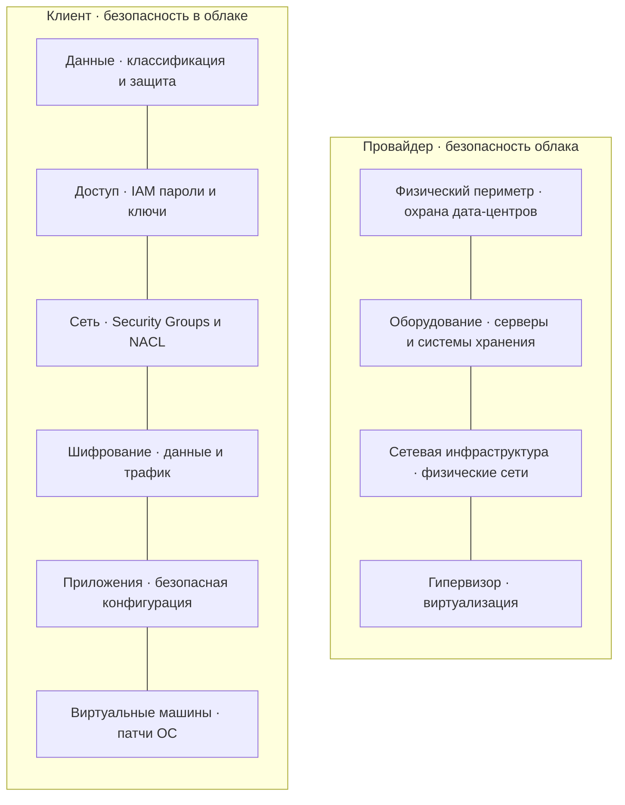
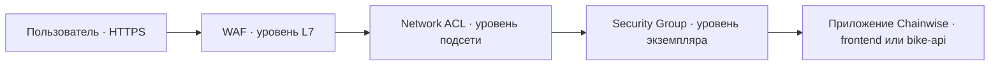

# Лабораторная работа №7. Безопасность облачной инфраструктуры Chainwise

В работе спроектирована защита Chainwise с учетом решений из предыдущих
лабораторных. VPC использует диапазон `10.100.0.0/16` и три зоны доступности.
Публичными точками входа остаются CloudFront и ALB, прикладные сервисы работают
в private подсетях, а PostgreSQL находится в отдельных data подсетях без
публичных адресов. Системные диски размещены на EBS gp3, узлы PostgreSQL
используют EBS io2, общий каталог хранится в Regional EFS, а статика и резервные
копии находятся в разных бакетах S3.

## Этап 1. Модель Shared Responsibility

### 1.1. Разделение ответственности

Провайдер отвечает за безопасность самого облака, поэтому он защищает
дата-центры, оборудование, физическую сеть, гипервизор и слой виртуализации.
Клиент отвечает за то, что размещает внутри облака, включая данные, учетные
записи, сетевые правила, шифрование, приложения и гостевые операционные системы.



Исходный файл диаграммы находится в `scheme/shared-responsibility.mmd`.

### 1.2. Граница ответственности в IaaS, PaaS и SaaS

Базовая граница ответственности проходит на уровне гипервизора. Провайдер
защищает физическую инфраструктуру и виртуализацию, а клиент управляет ресурсами
поверх этого слоя. При переходе от IaaS к SaaS провайдер берет на себя больше
технических компонентов, но клиент продолжает отвечать за свои данные и доступ
к ним.

| Модель и пример | За что отвечает провайдер | За что отвечает клиент |
| --- | --- | --- |
| IaaS и Amazon EC2 | Дата-центр, оборудование, физическая сеть, гипервизор и виртуализация | Гостевая ОС, патчи, приложения, IAM, Security Groups, NACL, шифрование и данные |
| PaaS и Amazon RDS | Инфраструктура, виртуализация, ОС сервера базы, обслуживание управляемого сервиса и установка его исправлений | Учетные записи базы, схема данных, сетевой доступ, параметры экземпляра, настройки резервного копирования и сами данные |
| SaaS и Microsoft 365 | Инфраструктура, ОС, приложение, его обновления и доступность | Пользователи, MFA, права совместного доступа, классификация, срок хранения и содержимое данных |

Клиент не передает провайдеру ответственность за смысл и владельцев данных. Он
решает, что загружать, кому разрешать чтение и изменение, как долго хранить
информацию и когда ее удалять. Провайдер обеспечивает работу и защиту сервиса в
пределах выбранной модели.

### 1.3. Утечка через неправильно настроенную Security Group

За утечку отвечает клиент, потому что размещение базы в публичной подсети и
правила Security Group относятся к безопасности внутри облака. Провайдер в этом
случае применил конфигурацию, которую задал клиент, и не нарушил свою часть
модели.

В Chainwise PostgreSQL находится в data подсетях без публичных адресов.
`SG-Database` разрешает TCP порт `5432` только от `SG-Bike`, а NACL data
подсетей не пропускает подключения к базе из интернета. Изменения этих правил
записываются в журнал аудита.

## Этап 2. Управление доступом IAM

### 2.1. Политика сервисного аккаунта

По условию CI получает доступ к префиксу `chainwise-ci/` в бакете
`my-backup-bucket`. В пятой лабораторной рабочий бакет резервных копий назван
`chainwise-backups`, поэтому `my-backup-bucket` здесь используется как точное
имя из задания. При переносе политики в проект меняется только имя бакета.

Разрешены загрузка и чтение объектов, а запрос должен приходить из диапазона
`10.0.0.0/24`. Удаление объекта и конкретной версии запрещено явным `Deny`.

```json
{
  "Version": "2012-10-17",
  "Statement": [
    {
      "Sid": "AllowReadWriteChainwiseArtifacts",
      "Effect": "Allow",
      "Action": [
        "s3:PutObject",
        "s3:GetObject"
      ],
      "Resource": "arn:aws:s3:::my-backup-bucket/chainwise-ci/*",
      "Condition": {
        "IpAddress": {
          "aws:SourceIp": "10.0.0.0/24"
        }
      }
    },
    {
      "Sid": "DenyObjectDeletion",
      "Effect": "Deny",
      "Action": [
        "s3:DeleteObject",
        "s3:DeleteObjectVersion"
      ],
      "Resource": "arn:aws:s3:::my-backup-bucket/chainwise-ci/*"
    }
  ]
}
```

Звездочка используется только в конце ARN для объектов выбранного префикса.
Ресурс `*`, действия `s3:*` и права администратора в политике отсутствуют. Явный
запрет удаления имеет приоритет, даже если другая политика случайно добавит
разрешение на эту операцию.

### 2.2. Сущности IAM

| Сущность | Кто это | Как подтверждает личность |
| --- | --- | --- |
| Пользователь (IAM User) | Администратор или DevOps инженер Chainwise | Пароль и MFA, для отдельных программных задач также могут использоваться ключи |
| Сервисный аккаунт | CI Chainwise, процесс резервного копирования или телеметрия | Идентификация рабочей нагрузки, временный токен или отдельный ключ с ротацией |
| Роль (IAM Role) | Временные разрешения для EC2 с `bike-api`, CI или задачи резервного копирования | Доверенный сервис принимает роль, после чего STS выдает временные учетные данные |

Люди используют отдельные пользовательские учетные записи с MFA. Сервисы
работают через роли и временные данные, поэтому личный аккаунт разработчика и
постоянный root аккаунт в production не используются.

### 2.3. Принцип минимальных привилегий

Принцип least privilege означает, что субъект получает только действия над теми
ресурсами, которые нужны для его задачи. Правильный вариант для CI разрешает
`s3:PutObject` и `s3:GetObject` только внутри
`my-backup-bucket/chainwise-ci/`, ограничивает источник и явно запрещает
удаление.

Плохой вариант выдает CI права администратора или `s3:*` на ресурс `*`. При
утечке такого ключа злоумышленник сможет прочитать, изменить и удалить объекты в
других бакетах, хотя публикация артефактов этого не требует.

### 2.4. Типичные ошибки IAM

| Ошибка | Последствие | Как предотвратить |
| --- | --- | --- |
| Использование root или ключа администратора для обычных операций | Один украденный секрет позволяет изменить VPC, удалить бакеты и получить данные Chainwise | Оставить root только для редких операций, включить MFA и создать отдельные роли |
| Долгоживущие ключи без ротации | Забытый ключ CI продолжает давать доступ к артефактам и резервным копиям | Использовать временные учетные данные, ротировать нужные ключи и удалять неиспользуемые |
| Постоянные ключи внутри приложения вместо роли | Ключ приходится хранить вместе с конфигурацией `bike-api` | Назначить EC2 роль и получать временные данные через STS |
| Отсутствие MFA у пользователей | Украденного пароля администратора достаточно для входа в окружение Chainwise | Включить MFA для всех пользователей, особенно для привилегированных |
| Широкие действия и ресурсы | CI может получить доступ не только к своему префиксу, но и к другим данным проекта | Перечислить `GetObject` и `PutObject`, ARN нужного бакета и префикс `chainwise-ci/` |

## Этап 3. Управление секретами

### 3.1. Сравнение Vault и AWS Secrets Manager

| Критерий | HashiCorp Vault | AWS Secrets Manager |
| --- | --- | --- |
| Платформа / привязка к облаку | Подходит Chainwise при переносе между AWS, другим облаком и локальной средой | Подходит, если Chainwise остается полностью в AWS |
| Динамические секреты (TTL) | Может выдавать `bike-api` временные учетные данные PostgreSQL и отзывать их после TTL | Основной сценарий для Chainwise связан с хранением и ротацией пароля, динамическая выдача ограничена интеграциями |
| Автоматическая ротация | Настраивается для секрета PostgreSQL через database secrets engine | Поддерживается как управляемая функция и проще всего работает с RDS |
| Unseal / самоуправление | Команда Chainwise сама обслуживает кластер и настраивает ручной или автоматический unseal | Unseal отсутствует, инфраструктурой сервиса управляет AWS |
| Стоимость и администрирование | Community версия не требует платы за сервис, но Chainwise нужны вычислительные ресурсы, резервирование и сопровождение | Оплачиваются секреты и обращения, при этом AWS выполняет большую часть эксплуатации |
| Интеграция с IAM | Vault использует собственные policies и auth methods, а EC2 может входить через AWS auth method | Доступ сервисов Chainwise напрямую задается через AWS IAM и ресурсные политики |

Для полностью AWS стека проще выбрать AWS Secrets Manager, потому что он уже
интегрирован с IAM, KMS и RDS. Для мультиоблачной или локальной инфраструктуры
удобнее Vault, так как он не зависит от одного провайдера и умеет выдавать
динамические секреты.

В Chainwise сохраняется Vault, выбранный в третьей лабораторной. Такой выбор не
мешает использовать AWS для текущей схемы и позволяет перенести сервис к
другому провайдеру. Vault размещается в закрытой служебной подсети, работает с
TLS, хранит данные в зашифрованном виде и ведет аудит обращений.

### 3.2. Чек-лист обращения с секретами

1. <u>Никогда не хранить пароли, токены и ключи в коде, файлах репозитория и истории git</u>.
2. Передавать секрет приложению только во время выполнения и не записывать его в логи.
3. Использовать динамические секреты с TTL или регулярно ротировать статические значения.
4. Разрешать чтение секрета только тем ролям и сервисам, которым он действительно нужен.
5. Шифровать хранилище и вести аудит получения, изменения, ротации и отзыва секретов.

### 3.3. Действия после публикации пароля базы данных

Пароль считается скомпрометированным сразу после появления в публичном
репозитории, даже если файл быстро удалить. Действия выполняются в следующем
порядке.

1. Старая учетная запись блокируется или ее пароль немедленно меняется.
2. Доступ к PostgreSQL проверяется и временно сужается до необходимых экземпляров `bike-api`.
3. Новый пароль помещается в Vault, а `bike-api` получает право только на чтение нужного секрета.
4. Приложение переводится на получение секрета во время запуска или на динамические учетные данные с небольшим TTL.
5. Проверяются журналы PostgreSQL, Vault, IAM и VPC Flow Logs за весь период возможной утечки.
6. Секрет удаляется из текущей версии и истории git, но это не заменяет его ротацию.
7. В CI и перед коммитом включается поиск секретов, а сборка блокируется при обнаружении ключей или паролей.

Если в журналах есть неизвестные подключения, выгрузка данных или изменение
записей, начинается отдельное расследование. Затронутые учетные записи
отзываются, доступы пересматриваются, а данные восстанавливаются из проверенной
копии при необходимости.

## Этап 4. Шифрование данных

### 4.1. Шифрование in-transit и at-rest

Шифрование in-transit защищает данные во время передачи. В Chainwise внешние
запросы идут по HTTPS с TLS 1.2 или TLS 1.3 от пользователя к CloudFront и ALB,
а соединения `bike-api` с PostgreSQL также используют TLS. Это два примера
защиты сетевого трафика.

Шифрование at-rest защищает уже записанную информацию. EBS тома gp3 и io2
шифруются через KMS, а объекты в бакетах `chainwise-frontend-assets` и
`chainwise-backups` используют SSE-KMS. Снапшоты EBS, резервные копии и старые
версии объектов сохраняют шифрование.

TLS не заменяет шифрование диска, потому что после передачи данные выходят из
защищенного соединения и записываются в хранилище. Шифрование at-rest тоже не
заменяет TLS, потому что при отправке расшифрованные данные иначе можно было бы
перехватить в сети.

### 4.2. Envelope encryption в KMS

Приложение или облачный сервис запрашивает у KMS ключ данных `Data Key` и
использует его открытую копию для шифрования. KMS также возвращает этот ключ в
зашифрованном виде, после чего открытая копия удаляется из памяти, а рядом с
данными хранится только зашифрованная. Для чтения зашифрованный `Data Key`
отправляется обратно в KMS. Мастер-ключ, который сейчас называется KMS key и
раньше назывался CMK, используется внутри HSM и не покидает границу KMS в
открытом виде.

### 4.3. Что и как шифруется

| Что шифруем | Чем / как | Сервис |
| --- | --- | --- |
| Трафик (сеть) | HTTPS с TLS 1.2 и TLS 1.3, а между `bike-api` и PostgreSQL используется TLS | CloudFront, ALB, ACM и PostgreSQL, Route 53 используется для DNS |
| Диски виртуальных машин | EBS encryption с отдельным KMS key для production | EBS gp3 и io2, AWS KMS |
| Объекты в S3 | SSE-KMS, закрытый origin статики и отдельные права на бакет резервных копий | S3 `chainwise-frontend-assets`, S3 `chainwise-backups` и AWS KMS |
| Базы данных | Зашифрованные io2, TLS подключения и зашифрованные снапшоты | PostgreSQL, EBS и AWS KMS |
| Резервные копии | SSE-KMS для всех классов жизненного цикла и версий | S3 `chainwise-backups`, AWS KMS |

Ключи разделяются как минимум по окружениям production и development. Для
резервных копий используется отдельный KMS key, чтобы доступ приложения к
своему диску не давал права расшифровать весь архив.

### 4.4. Типичные ошибки шифрования

| Ошибка | Чем она опасна |
| --- | --- |
| Диски и снапшоты создаются без шифрования | Получив доступ к носителю или копии, злоумышленник сможет прочитать данные без приложения |
| Один KMS key используется для всех окружений и типов данных | Компрометация одной политики открывает сразу production, development и резервные копии |
| Разрешены старые версии TLS | Соединение может использовать слабый протокол и устаревшие алгоритмы |
| Ключи и данные для расшифрования хранятся в коде | Получив репозиторий, злоумышленник получает и средство доступа к защищенным данным |

## Этап 5. Сетевая защита

### 5.1. Сравнение Security Group и Network ACL

| Свойство | Security Group | Network ACL |
| --- | --- | --- |
| Уровень работы | Сетевой интерфейс экземпляра, например `SG-Bike` или `SG-Database` | Граница public, private или data подсети Chainwise |
| Stateful / Stateless | Stateful, ответ на разрешенный запрос к сервису проходит автоматически | Stateless, для data и private подсетей входящий и ответный исходящий трафик разрешаются отдельно |
| Тип правил | Только Allow, поэтому открываются конкретные связи между сервисами | Allow и Deny, поэтому можно отдельно блокировать источник для всей подсети |
| Порядок оценки правил | Порядок правил `SG-Bike` и других групп не влияет на результат | Правила проверяются по номеру до первого совпадения |

### 5.2. Порядок прохождения трафика



Исходный файл диаграммы находится в `scheme/traffic-protection.mmd`.

WAF подключается к CloudFront и публичному ALB и проверяет содержимое HTTP
запроса. Затем NACL фильтрует адреса, протокол и порты на границе подсети, а
Security Group применяет правила конкретного сетевого интерфейса. Только после
этого запрос доходит до приложения.

### 5.3. Правила Security Group

Для публичного HTTPS используется правило `Allow inbound TCP/443 from
0.0.0.0/0 to SG-ALB`. Порт `80` на ALB можно оставить только для
перенаправления на HTTPS. Экземпляры frontend и `bike-api` не имеют публичных
адресов и принимают прикладной трафик только от `SG-ALB`.

Для случая из задания административный доступ задается правилом `Allow inbound
TCP/22 from 10.0.1.0/24 to SG-Admin`. Диапазон `10.0.1.0/24` считается
внутренней сетью администраторов, которая подключена через VPN или защищенный
служебный узел. Он не заменяет диапазон VPC Chainwise `10.100.0.0/16`.
Подключения к порту `22` из интернета запрещены. В рабочей схеме вместо прямого
SSH предпочтительно использовать управляемый сеанс без публичного порта.

PostgreSQL использует правило `Allow inbound TCP/5432 from SG-Bike to
SG-Database`. Доступ от ALB, frontend, других сервисов и из интернета не
разрешен. Для репликации узлов базы TCP порт `5432` разрешен внутри
`SG-Database`.

Внутренняя цепочка сервисов остается такой же, как в первой лабораторной.
`SG-Frontend` принимает TCP `8080` только от `SG-ALB`, а `SG-Bike` принимает
TCP `8081` от `SG-ALB` и `SG-Frontend`. Затем `SG-Maintenance` принимает TCP
`8082` только от `SG-Bike`, `SG-Weather` принимает TCP `8083` только от
`SG-Maintenance`, `SG-Reminder` принимает TCP `8084` только от `SG-Weather`, а
`SG-User` принимает TCP `8085` только от `SG-Reminder`. Это сохраняет ранее
выбранные связи и не открывает внутренние API напрямую пользователю.

### 5.4. Защита WAF

WAF блокирует три основные группы угроз уровня приложения.

1. SQL Injection пытается передать SQL код через параметры профиля или поездки и добраться до данных PostgreSQL.
2. XSS пытается сохранить вредоносный сценарий в данных профиля или напоминания, чтобы frontend вернул его другому пользователю.
3. Боты и DDoS уровня приложения создают большое число запросов к `bike-api`, проверке обслуживания и погодным рекомендациям.

Security Group не видит различие между обычным и вредоносным запросом, потому
что оба приходят по TCP порту `443`. Для обнаружения атаки нужно анализировать
URL, заголовки, параметры и тело HTTP запроса, а это делает WAF на уровне L7.

### 5.5. Подсети и сетевые фильтры

| Зона / компонент | Подсеть / уровень | Тип фильтра | Stateful/Stateless | Ключевое правило |
| --- | --- | --- | --- | --- |
| Веб-фронтенд Chainwise | Публичный CloudFront и ALB | WAF и Security Group | WAF анализирует L7, SG stateful | Разрешить TCP 443, а WAF блокирует SQLi, XSS и нежелательных ботов |
| Админ-доступ | Внутренняя сеть через VPN | `SG-Admin` | Stateful | Разрешить TCP 22 только от `10.0.1.0/24` |
| PostgreSQL | Data подсети `10.100.21.0/24`, `10.100.22.0/24`, `10.100.23.0/24` | `SG-Database` и NACL | Stateful и stateless | Разрешить TCP 5432 только от `SG-Bike` и для репликации внутри группы базы |
| Вся VPC Chainwise | Public, private и data подсети | Network ACL | Stateless | Использовать Allow и Deny по приоритету, отдельно разрешать ответный трафик |
| Приложение Chainwise | L7 перед CloudFront и ALB | WAF | Не применимо | Блокировать SQLi, XSS, ботов и DDoS уровня приложения |

Поскольку NACL не хранит состояние, в нем отдельно разрешаются ответные
соединения на временные клиентские порты. Для Security Groups отдельное правило
обратного направления не требуется.

### 5.6. Аудит действий

CloudTrail записывает изменения IAM, принятие ролей, обращения к KMS и операции
с Vault инфраструктурой. Для критичных бакетов включаются S3 data events, чтобы
видеть чтение и изменение объектов. Vault audit device записывает получение,
изменение и ротацию секретов, а доступ к PostgreSQL проверяется по журналам базы.

VPC Flow Logs из первой лабораторной продолжают собирать принятые и отклоненные
сетевые соединения. Журналы отправляются в отдельное хранилище, доступное только
роли аудита, и для него задается срок хранения. Оповещения создаются при
изменении политик IAM и KMS, отключении аудита, массовом чтении секретов,
повторяющихся отказах доступа и попытках подключения к порту базы не от
`SG-Bike`.

## Этап 6. Выводы

Защита Chainwise добавлена поверх уже выбранной сети и хранилищ, поэтому адреса
подсетей и связи сервисов не менялись. Пользовательский трафик проходит через
WAF, NACL и Security Group, а PostgreSQL остается в закрытых data подсетях и
принимает подключения только от `bike-api`.

Для людей используются отдельные учетные записи с MFA, а приложения получают
временные права через роли. Секреты остаются в Vault, шифруются и ротируются,
диски и S3 защищаются через KMS, а сетевой трафик идет по TLS. Аудит объединяет
события IAM, Vault, KMS, S3, PostgreSQL и VPC Flow Logs, поэтому изменение
доступа или подозрительное обращение можно связать с конкретной учетной записью.

Работа была проектной и реальные облачные ресурсы не создавались, поэтому после
ее завершения удалять ресурсы у провайдера не потребовалось.

## Самопроверка

| Требование | Результат |
| --- | --- |
| Обе Mermaid диаграммы используют отдельную строку для каждого ребра | Выполнено |
| Граница Shared Responsibility определена на уровне гипервизора | Выполнено |
| IAM политика не содержит административных действий и ресурса `*` | Выполнено |
| Сервисный аккаунт не может удалять объекты и их версии | Выполнено |
| Секреты не хранятся в коде и git | Выполнено |
| Для секретов предусмотрены TTL или ротация, IAM ограничения и аудит | Выполнено |
| TLS 1.2 и TLS 1.3 используются при передаче | Выполнено |
| EBS, S3, PostgreSQL, снапшоты и бэкапы шифруются через KMS | Выполнено |
| PostgreSQL не доступен из интернета | Выполнено |
| Созданы уровни WAF, NACL и Security Group | Выполнено |
| Stateful и stateless фильтры разведены по смыслу | Выполнено |
| Аудит IAM, секретов, KMS, S3 и сети описан | Выполнено |
| Реальные облачные ресурсы после работы отсутствуют | Выполнено |

## Контрольные вопросы

### 1. На ком безопасность облака и безопасность в облаке

Провайдер отвечает за дата-центры, оборудование, физическую сеть, гипервизор и
виртуализацию. Клиент отвечает за данные, IAM, сетевые правила, гостевые ОС,
приложения и шифрование. Базовая граница проходит на уровне гипервизора.

### 2. Что такое IAM политика и как работает явный Deny

IAM политика описывает разрешенные и запрещенные действия над конкретными
ресурсами при заданных условиях. По умолчанию доступ запрещен, разрешение нужно
добавить явно, а подходящий `Deny` всегда перекрывает `Allow`.

### 3. Чем пользователь IAM отличается от сервисного аккаунта

Пользователь представляет человека и обычно входит с паролем и MFA. Сервисный
аккаунт представляет приложение, скрипт или CI, поэтому для него лучше
использовать роль и временные учетные данные с узкими правами.

### 4. Что означает принцип минимальных привилегий

Субъект получает только те действия и ресурсы, которые нужны для его задачи. CI
может загрузить и прочитать объект только в своем префиксе бакета, но не может
удалять файлы, менять политики и обращаться к другим ресурсам.

### 5. Почему секреты нельзя хранить в коде

Репозиторий копируется на компьютеры разработчиков, в CI и резервные системы, а
удаленный файл остается в истории. Vault и Secrets Manager хранят секрет
отдельно, шифруют его, ограничивают доступ, выполняют ротацию и записывают
обращения в аудит.

### 6. Чем отличается шифрование in-transit от at-rest

In-transit защищает передачу, например HTTPS от пользователя до ALB и TLS от
`bike-api` до PostgreSQL. At-rest защищает записанные данные, например EBS тома,
объекты S3, снапшоты и резервные копии.

### 7. Как работает envelope encryption

Данные шифруются отдельным `Data Key`, а сам ключ данных шифруется KMS key.
Рядом с данными хранится только его зашифрованная копия. Для расшифрования она
передается в KMS, при этом материал мастер-ключа остается внутри HSM и не
выдается приложению в открытом виде.

### 8. Чем Security Group отличается от Network ACL

Security Group применяется к сетевому интерфейсу, является stateful и содержит
только разрешающие правила. NACL действует на подсеть, является stateless,
поддерживает Allow и Deny и проверяет правила по номеру. Ответный трафик для NACL
нужно разрешать отдельно.

### 9. Что такое WAF

WAF фильтрует HTTP трафик на уровне L7. Он анализирует URL, параметры, заголовки
и тело запроса, поэтому может блокировать SQL Injection, XSS, нежелательных
ботов и DDoS уровня приложения.

### 10. В каком порядке проходит трафик

В логической схеме входящий запрос проходит через WAF, затем через NACL
подсети, после этого через Security Group конкретного компонента и только потом
попадает в приложение.
