# Лабораторная работа №8. Elasticsearch и логи Chainwise

## Часть 1. Развёртывание Elasticsearch и Kibana

Для работы с логами был поднят одноузловой Elasticsearch 8.19.25 и Kibana той
же версии. Сервисы запускаются через `docker-compose.yml`, а security для
локального стенда отключён, поэтому запросы можно выполнять напрямую из Kibana
Dev Tools.

После создания первого индекса кластер получил статус `yellow`. Primary shard
был назначен и оставался доступным, а его реплика не могла разместиться, потому
что в кластере был только один узел. Elasticsearch не хранит primary shard и
его копию на одном узле, иначе одна неисправность уничтожила бы обе копии.

Чтобы статус стал `green`, нужно добавить второй узел и разместить реплику на
нём. Для локальной разработки можно вместо этого установить
`number_of_replicas` равным нулю, но это только уберёт нераспределённую реплику,
а отказоустойчивости у данных не появится.

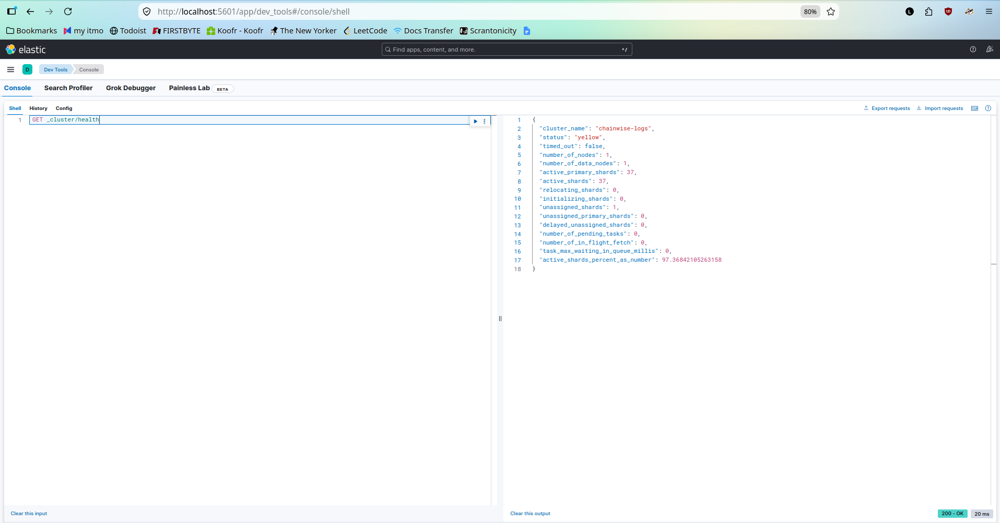

## Часть 2. Данные, индекс и поиск

Для проверки были подготовлены 40 JSON логов сервисов Chainwise. В них
используются существующие части проекта, среди которых `frontend`, `bike-api`,
`maintenance-api`, `maintenance-worker`, `weather-integration`,
`notification-worker` и `postgresql`. Сообщения связаны с поездками,
обслуживанием велосипедов, погодой, уведомлениями и работой базы.

Маппинг задаётся в index template и не создаёт поля автоматически. Время
хранится как `date`, уровни и имена сервисов как `keyword`, текст сообщения как
`text`, а идентификатор одной цепочки запросов как `keyword`.

| Поле | Тип | Для чего используется |
| --- | --- | --- |
| `timestamp` | `date` | Фильтрация и сортировка логов по времени |
| `level` | `keyword` | Точный фильтр и агрегация по уровню |
| `service` | `keyword` | Точный фильтр и группировка по сервису |
| `message` | `text` | Полнотекстовый поиск по содержимому сообщения |
| `trace_id` | `keyword` | Поиск всех сообщений одной операции |

Логи загружались через Bulk API в alias `chainwise-logs`. Alias указывает на
текущий индекс для записи, поэтому его имя не нужно менять в приложении после
ротации.

### 2.1. Полнотекстовый поиск по message

Поле `message` имеет тип `text`, поэтому запрос `match` ищет не полное
совпадение строки, а отдельные слова из сообщения. По слову `цепи` были найдены
сообщения, связанные с проверкой и обслуживанием цепи велосипеда.

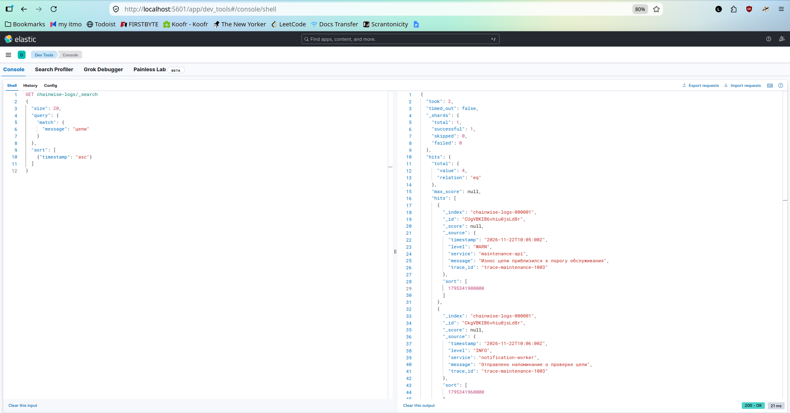

### 2.2. Фильтр по уровню и времени

Для разбора ошибок использовался точный фильтр `level = ERROR` и диапазон времени в час. `level` хранится как `keyword`, поэтому
в результат не попадают другие уровни, а тип `date` позволяет одновременно
ограничить время.

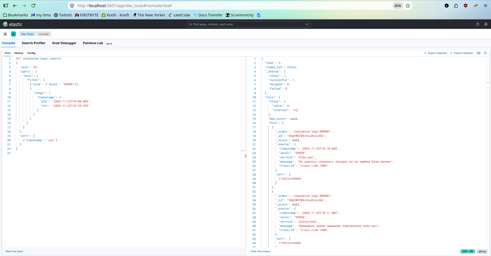

### 2.3. Поиск по trace_id

По `trace-ride-1007` были собраны сообщения одной поездки от нескольких
сервисов. Такой поиск помогает пройти по одной операции через `frontend`,
`bike-api`, обработчик обслуживания и отправку уведомления, не просматривая все
логи подряд.

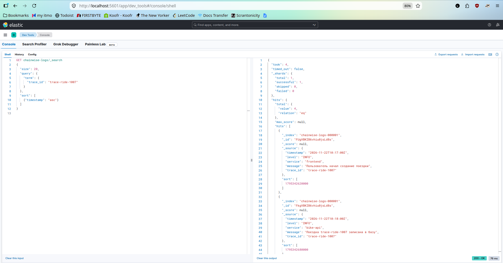

### 2.4. Агрегация и визуализация

Агрегация по `level` разделила исходные 40 записей на 22 сообщения `INFO`, 10
сообщений `WARN` и 8 сообщений `ERROR`. Для неё используется поле типа
`keyword`, так как здесь нужны точные значения, а не анализированный текст.

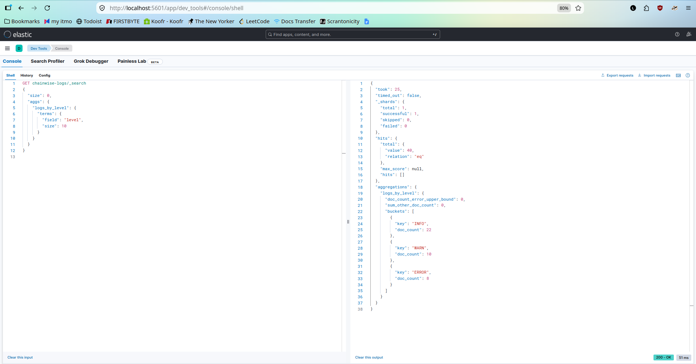

Для просмотра в Kibana было создано data view `Chainwise logs` по шаблону
`chainwise-logs-*`, а в Lens построена столбчатая диаграмма количества записей
по уровню. На ней сразу видно соотношение обычных сообщений, предупреждений и
ошибок.

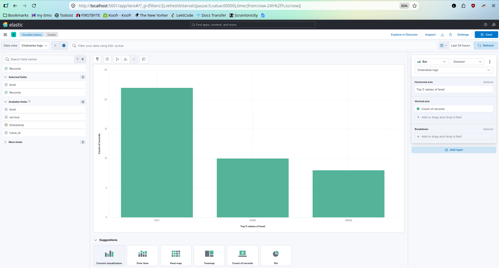

## Часть 3. ILM и rollover

Политика `chainwise-logs-policy` создаёт новый индекс при выполнении любого из
трёх условий. Размер primary shard достигает 1 МБ, число документов достигает
50 или возраст индекса достигает одного дня. Delete phase удаляет старый индекс
через один день после rollover. Такие маленькие пороги подходят только для
демонстрационного стенда, но позволяют увидеть ротацию без большого объёма
логов и долгого ожидания.

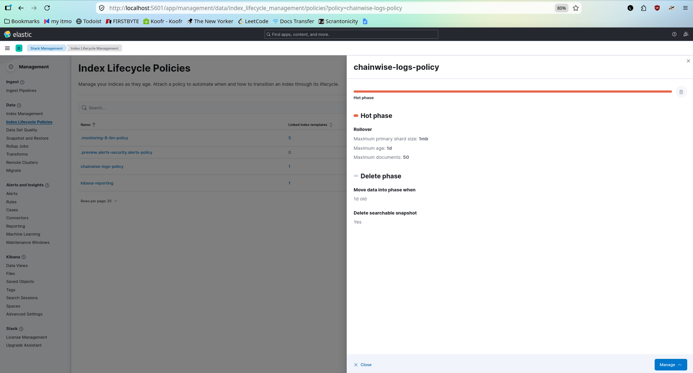

Политика и alias подключены через шаблон `chainwise-logs-template`. Первый
индекс называется `chainwise-logs-000001`, а все документы записываются через
alias `chainwise-logs`. После загрузки дополнительных 20 сообщений число
документов превысило порог 50. ILM создал
`chainwise-logs-000002` и переключил запись через alias на него, при этом первый
индекс остался доступен для поиска.

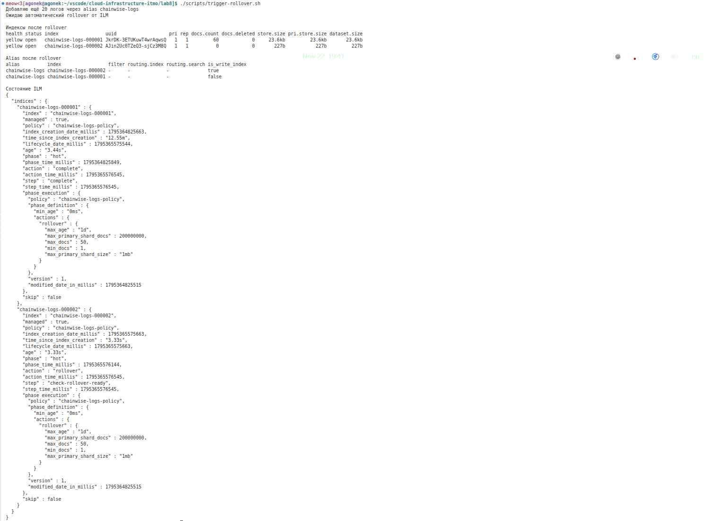

Общий список индексов также показывает оба индекса Chainwise. Первый содержит
60 загруженных документов, а второй уже создан и используется для следующих
записей.

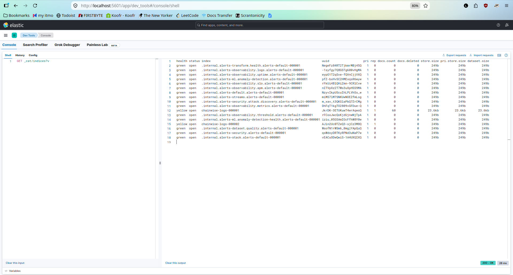

## Часть 4. Мониторинг

Для Elasticsearch был настроен `elasticsearch-exporter`, а метрики собираются
Prometheus. На дашборд Grafana вынесены состояние кластера, число
нераспределённых shards, использование JVM heap, свободное место, число
документов и общий размер индексов. Этого достаточно, чтобы одновременно видеть
доступность кластера, запас основных ресурсов и рост хранимых логов.

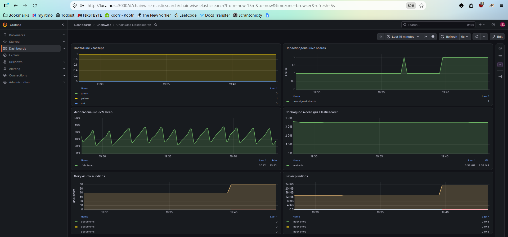

Для алертов выбраны три метрики, которые показывают разные причины проблем.

| Alert | Условие | Что он ловит и чем это грозит |
| --- | --- | --- |
| `ChainwiseElasticsearchClusterRed` | `elasticsearch_cluster_health_status{color="red"} == 1` в течение 30 секунд | Ловит отсутствие назначенного primary shard. Часть логов становится недоступной для поиска, а запись в затронутый индекс может перестать работать |
| `ChainwiseElasticsearchHeapHigh` | JVM heap выше 80 процентов две минуты | Ловит устойчивую нехватку памяти. Сборка мусора начинает занимать больше времени, запросы замедляются, а затем процесс может завершиться с ошибкой памяти |
| `ChainwiseElasticsearchDiskLow` | Свободного места меньше 1 ГиБ одну минуту | Ловит заполнение диска. Новые shards не смогут размещаться, а Elasticsearch может заблокировать запись, поэтому свежие логи перестанут сохраняться |

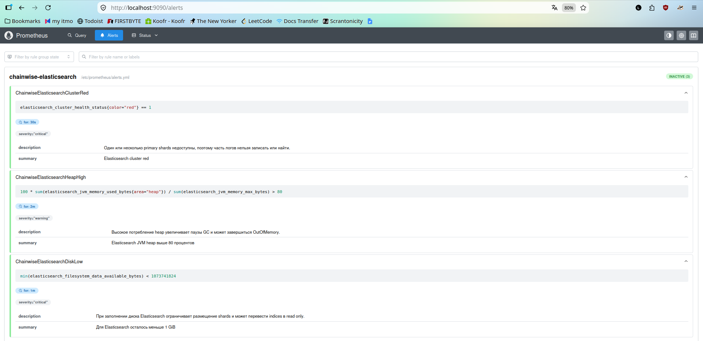
