# Лабораторная работа №9. Управление затратами Chainwise

Для Chainwise была составлена модель затрат в Yandex Cloud. Полноценная
инфраструктура в облаке не разворачивалась, а стоимость production ресурсов
рассчитывалась на официальном калькуляторе. Реально была создана только
маленькая демонстрационная ВМ, на которой проверялись метки, после чего ресурс
был удалён.

В Yandex Cloud обычная ВМ соответствует модели On-Demand, прерываемая ВМ
соответствует Spot, а аналогом Reserved является резервируемое потребление CVoS.
Для объектного хранилища используются классы `STANDARD`, `COLD` и `ICE`, которые
соответствуют Standard, Standard-IA и Glacier из условия.

## Этап 1. Выбор моделей ценообразования

Для `frontend` и группы API нужна постоянно работающая базовая мощность, но во
время утренних и вечерних пиков количество экземпляров увеличивается. Поэтому
базовая часть покрывается CVoS на один год, а временные экземпляры оплачиваются
по обычному тарифу. В строке `bike-api` учтена прикладная группа, в которую
также входят `maintenance-api`, `weather-api`, `reminder-api` и `user-api`.

PostgreSQL работает круглосуточно и не может быть неожиданно остановлен, поэтому
для него выбран CVoS. Тестовая среда не хранит единственную копию данных и может
быть создана заново, поэтому она работает на прерываемой ВМ только в рабочее
время.

| Сервис | Характер нагрузки | Модель цены | Обоснование |
| --- | --- | --- | --- |
| `frontend` | Постоянная базовая нагрузка и пики перед поездками | CVoS на один год и On-Demand для пиков | Базовые экземпляры используются постоянно, а дополнительные нужны только на несколько часов |
| `bike-api` и внутренние API | Нагрузка повторяет обращения к frontend | CVoS на один год и On-Demand для пиков | Постоянная часть предсказуема, а пиковые экземпляры нельзя резервировать на весь месяц |
| PostgreSQL | Круглосуточная работа и постоянное хранение данных | CVoS на один год | Базу нельзя прерывать, а её вычислительные ресурсы используются постоянно |
| Тестовая среда | Рабочие дни с 10:00 до 18:00 | Прерываемая ВМ | Среду можно перезапустить, а остановка не влияет на пользователей production |
| Object Storage | Частый доступ к новым данным и редкий доступ к старым | `STANDARD`, `COLD` и `ICE` | Класс выбирается по возрасту данных и частоте чтения |

База данных и основная часть приложения не оставлены полностью на самом дорогом
обычном тарифе, а тестовая среда не резервируется на долгий срок.

## Этап 2. Расчёт стоимости

### 2.1. Исходная стоимость On-Demand

Для расчёта выбран регион Россия, платформа Intel Ice Lake и гарантированная
доля vCPU 100%. Исходные размеры отражают конфигурацию до оптимизации.
В этой таблице указана цена одного экземпляра каждого типа. Она нужна, чтобы
сравнить модели оплаты на одинаковой конфигурации. В production из прошлых
лабораторных `frontend`, группа API и PostgreSQL размещаются в трёх зонах,
поэтому стоимость production групп рассчитана отдельно в разделе 2.5.

| ВМ | vCPU | RAM | network SSD | On-Demand в месяц |
| --- | ---: | ---: | ---: | ---: |
| `frontend` | 4 | 8 ГБ | 30 ГБ | 5 901,84 ₽ |
| `bike-api` | 4 | 8 ГБ | 30 ГБ | 5 901,84 ₽ |
| PostgreSQL | 8 | 16 ГБ | 100 ГБ | 12 376,80 ₽ |
| Тестовая среда | 4 | 8 ГБ | 30 ГБ | 5 901,84 ₽ |
| **Итого** |  |  |  | **30 082,32 ₽** |

Калькулятор считает каждую конфигурацию минимум за месяц, поэтому на этом шаге
тестовая среда также показана как работающая полный месяц. Корректировка на её
рабочий график приведена отдельно ниже.

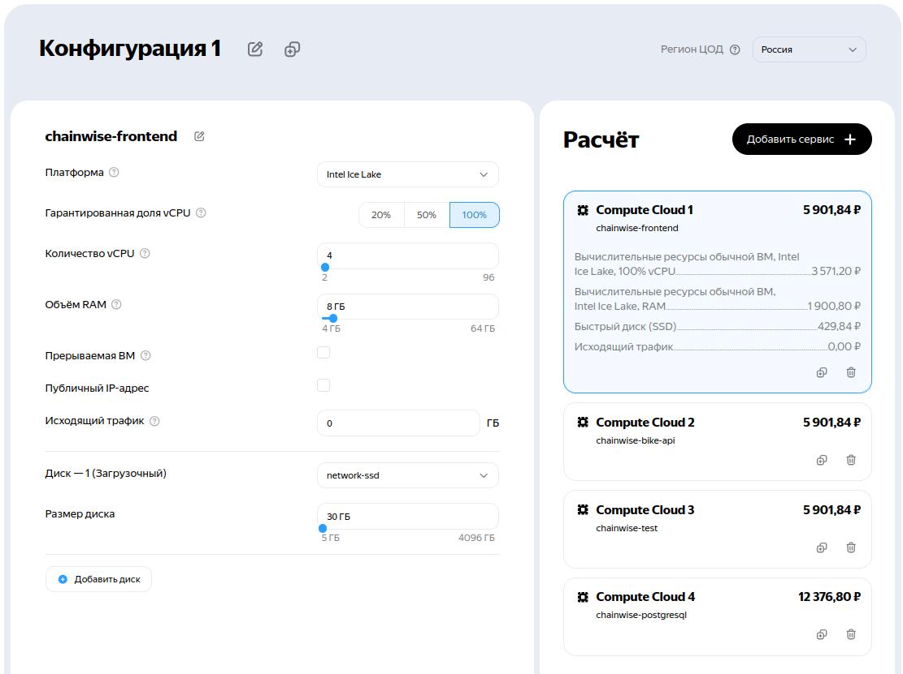

Для PostgreSQL вычислительные ресурсы стоят 10 944 ₽, а SSD объёмом 100 ГБ
стоит 1 432,80 ₽. Общая сумма всех четырёх конфигураций составляет
30 082,32 ₽ в месяц.

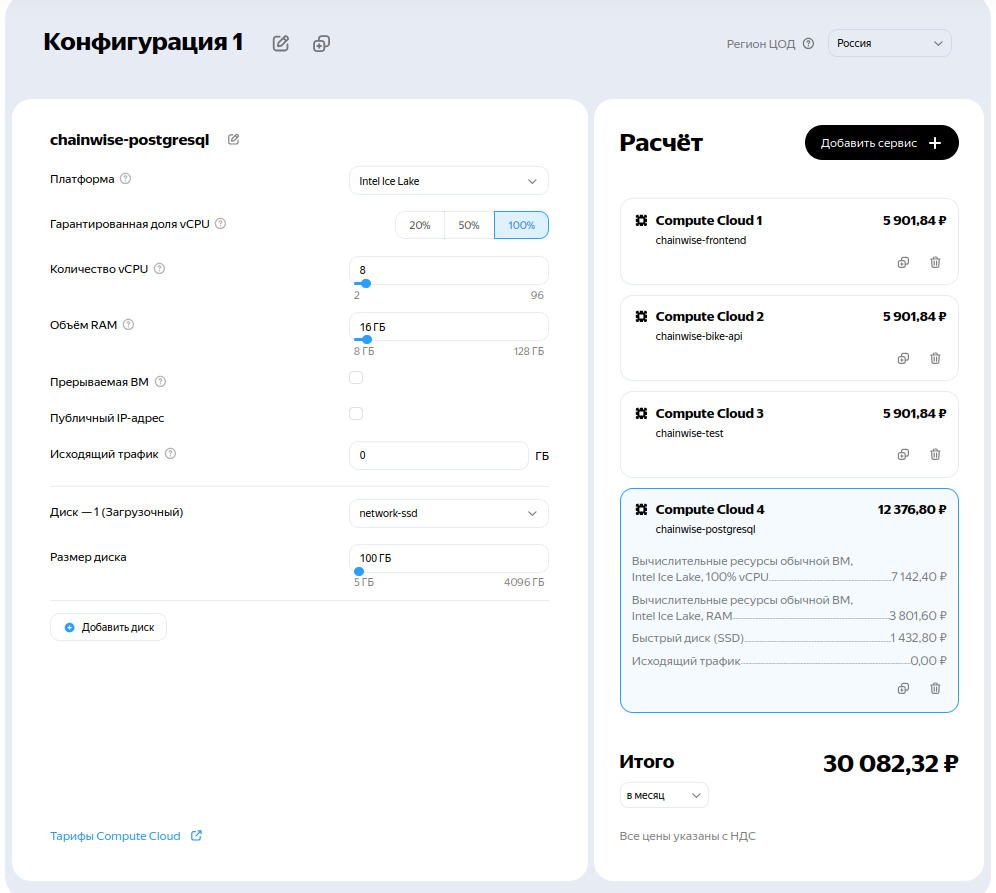

### 2.2. Расчёт CVoS

В предложении CVoS на один год стоимость одного vCPU снижается с 892,80 ₽ до
756 ₽ в месяц, а стоимость 1 ГБ RAM снижается с 237,60 ₽ до 201,60 ₽. Диск в
CVoS не входит и продолжает оплачиваться по обычной цене.

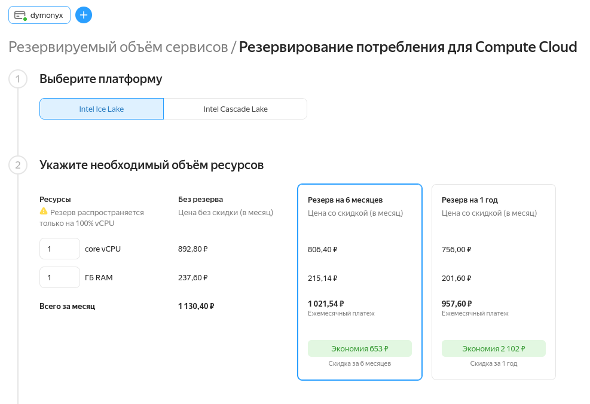

Для `frontend` и `bike-api` цена одного базового экземпляра рассчитывается как
`4 × 756 + 8 × 201,60 + 429,84`, поэтому получается 5 066,64 ₽. Для PostgreSQL
расчёт равен `8 × 756 + 16 × 201,60 + 1 432,80`, поэтому получается
10 706,40 ₽.

### 2.3. Прерываемая тестовая ВМ

Та же тестовая конфигурация в прерываемом режиме стоит 1 887,12 ₽ за полный
месяц вместо 5 901,84 ₽. Экономия составляет 4 014,72 ₽ или 68,02%.

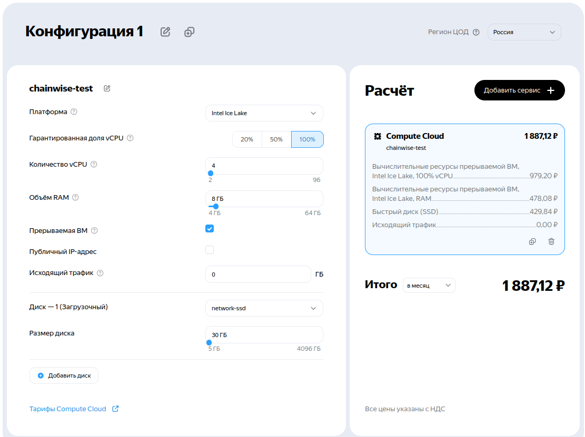

Фактически тестовая среда нужна 176 часов в месяц. При остановленной ВМ плата за
vCPU и RAM не начисляется, но загрузочный диск продолжает храниться. Для обычной
ВМ расчёт равен
`3 571,20 × 176 / 720 + 1 900,80 × 176 / 720 + 429,84`, что даёт
1 767,44 ₽. Для прерываемой ВМ получается
`979,20 × 176 / 720 + 478,08 × 176 / 720 + 429,84`, то есть 786,06 ₽. Такой
график дополнительно экономит 981,38 ₽ по сравнению с обычной ВМ при тех же
176 часах работы.

### 2.4. Сравнение моделей

В основной сравнительной таблице сохранён месячный период калькулятора, чтобы
для каждой строки использовалось одинаковое время. Для стабильных сервисов
учтён CVoS, а для тестовой среды использована месячная цена прерываемой ВМ.

| ВМ | On-Demand | Выбранная модель | Экономия | Экономия |
| --- | ---: | ---: | ---: | ---: |
| `frontend` | 5 901,84 ₽ | 5 066,64 ₽ | 835,20 ₽ | 14,15% |
| `bike-api` | 5 901,84 ₽ | 5 066,64 ₽ | 835,20 ₽ | 14,15% |
| PostgreSQL | 12 376,80 ₽ | 10 706,40 ₽ | 1 670,40 ₽ | 13,50% |
| Тестовая среда | 5 901,84 ₽ | 1 887,12 ₽ | 4 014,72 ₽ | 68,02% |
| **Итого** | **30 082,32 ₽** | **22 726,80 ₽** | **7 355,52 ₽** | **24,45%** |

Для одного типового набора комбинация моделей снижает месячную оценку на
24,45%. CVoS покрывает только постоянный объём, а дополнительные
экземпляры во время пиков остаются On-Demand, поэтому команда не обязана
оплачивать максимальную мощность весь месяц.

### 2.5. Стоимость production групп Chainwise

В предыдущих лабораторных production был распределён по трём зонам. Поэтому
одна строка `frontend` в калькуляторе означает цену одной ВМ, а для всей группы
эта цена умножается на три. То же самое относится к группе API и PostgreSQL,
где используются основной узел и две реплики. Тестовая среда остаётся в одном
экземпляре, потому что ей не нужна production отказоустойчивость.

| Группа | Экземпляров | On-Demand за один экземпляр | On-Demand за группу |
| --- | ---: | ---: | ---: |
| `frontend` | 3 | 5 901,84 ₽ | 17 705,52 ₽ |
| `bike-api` и внутренние API | 3 | 5 901,84 ₽ | 17 705,52 ₽ |
| PostgreSQL | 3 | 12 376,80 ₽ | 37 130,40 ₽ |
| Тестовая среда | 1 | 5 901,84 ₽ | 5 901,84 ₽ |
| **Итого** | **10** |  | **78 443,28 ₽** |

Если изменить только модель оплаты, три экземпляра `frontend` стоят
15 199,92 ₽, группа API столько же, три узла PostgreSQL стоят 32 119,20 ₽, а
прерываемая тестовая ВМ стоит 1 887,12 ₽. Общая сумма равна 64 406,16 ₽, а
экономия составляет 14 037,12 ₽ или 17,90%. Этого недостаточно для
целевого диапазона, поэтому к stateless сервисам применяется ещё и rightsizing.

| Группа | Что меняется | Стоимость после оптимизации |
| --- | --- | ---: |
| `frontend` | 3 ВМ по 2 vCPU и 4 ГБ, CVoS на один год | 8 244,72 ₽ |
| `bike-api` и внутренние API | 3 ВМ по 2 vCPU и 4 ГБ, CVoS на один год | 8 244,72 ₽ |
| PostgreSQL | 3 ВМ исходного размера, CVoS на один год | 32 119,20 ₽ |
| Тестовая среда | 1 прерываемая ВМ исходного размера | 1 887,12 ₽ |
| **Итого** |  | **50 495,76 ₽** |

Итоговая экономия для production групп равна 27 947,52 ₽ или 35,63%.
PostgreSQL в этот прогноз входит в исходном размере, потому что уменьшать базу
по условным показателям небезопасно. Её уменьшенная конфигурация ниже нужна для
сравнения в задании, но применять её можно только после сбора реальных метрик.

## Этап 3. Распределение затрат через метки

Для всех ресурсов используется один набор ключей `env`, `project`, `team` и
`cost_center`. Значения показывают окружение, проект, ответственную команду и
направление, на которое относится расход.

| Ресурс | `env` | `project` | `team` | `cost_center` |
| --- | --- | --- | --- | --- |
| `frontend` | `prod` | `chainwise` | `frontend` | `product` |
| `bike-api` | `prod` | `chainwise` | `backend` | `product` |
| `maintenance-api` | `prod` | `chainwise` | `backend` | `product` |
| `weather-api` | `prod` | `chainwise` | `integrations` | `product` |
| `reminder-api` | `prod` | `chainwise` | `notifications` | `product` |
| `user-api` | `prod` | `chainwise` | `backend` | `product` |
| PostgreSQL | `prod` | `chainwise` | `data` | `product` |
| Object Storage | `prod` | `chainwise` | `platform` | `operations` |
| Тестовая и демонстрационная ВМ | `test` | `chainwise` | `platform` | `education` |

На демонстрационной прерываемой ВМ были установлены все четыре обязательные
метки.

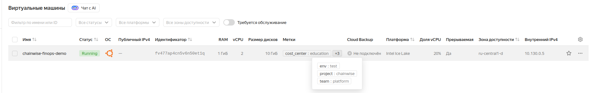

Если у ресурса нет обязательной метки, его стоимость не попадёт в нужную группу
проекта или команды и останется в категории без известного владельца. В таком
отчёте нельзя понять, кто создал расход и можно ли удалить ресурс, поэтому
оптимизация превращается в поиск вслепую. Проверку обязательных меток нужно
выполнять при создании ресурса через IaC и policy, а ресурсы без них не допускать
в production.

## Этап 4. Бюджет и алерты

Для практической проверки создан месячный бюджет `chainwise-lab9-budget` на
100 ₽. Он считает потребление с учётом скидок, отправляет уведомления выбранному
пользователю и действует для выбранных облака и каталога. Порог 50%
нужен как раннее предупреждение, а при 90% уже нужно останавливать
тестовые ресурсы и разбирать причину роста. Порог 100% оставлен как
последнее уведомление о полном исчерпании бюджета.

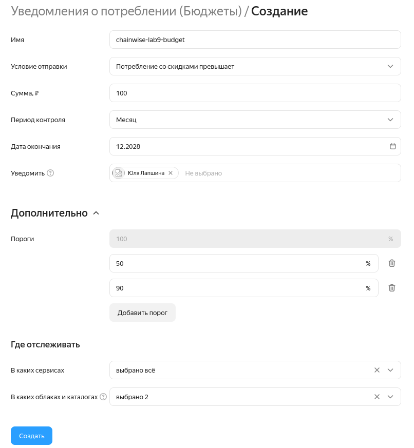

После создания бюджет перешёл в состояние `Active`. В списке видны пороги 50% и
90%, дополнительный порог 100%, месячный период и текущее
потребление 0 ₽ из 100 ₽.

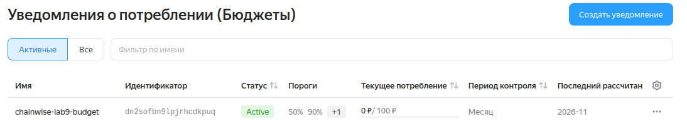

Бюджет на 100 ₽ используется только для безопасной демонстрации. Для
production групп из расчёта прогноз после оптимизации составляет 50 495,76 ₽ в
месяц, поэтому рабочий бюджет можно установить на 60 000 ₽ с теми же ранними
порогами и запасом на пики. Сам бюджет не останавливает ВМ, поэтому уведомление
на 50% даёт время отреагировать до достижения критического порога.

## Этап 5. Оптимизация затрат

### 5.1. Rightsizing

Для расчёта использована условная загрузка, потому что production Chainwise не
разворачивался в Yandex Cloud. Размеры уменьшаются только после оценки CPU и RAM,
а не просто ради минимальной цены.

| Ресурс | Условная загрузка CPU и RAM | Было | Стало | Было в месяц | Стало в месяц | Экономия |
| --- | --- | --- | --- | ---: | ---: | ---: |
| `frontend` | 25% и 45% | 4 vCPU, 8 ГБ | 2 vCPU, 4 ГБ | 5 901,84 ₽ | 3 165,84 ₽ | 46,36% |
| `bike-api` | 35% и 45% | 4 vCPU, 8 ГБ | 2 vCPU, 4 ГБ | 5 901,84 ₽ | 3 165,84 ₽ | 46,36% |
| PostgreSQL | 40% и 50% | 8 vCPU, 16 ГБ | 4 vCPU, 8 ГБ | 12 376,80 ₽ | 6 904,80 ₽ | 44,21% |
| Тестовая среда | 15% и 25% | 4 vCPU, 8 ГБ | 2 vCPU, 4 ГБ | 5 901,84 ₽ | 3 165,84 ₽ | 46,36% |
| **Итого** |  |  |  | **30 082,32 ₽** | **16 402,32 ₽** | **45,48%** |

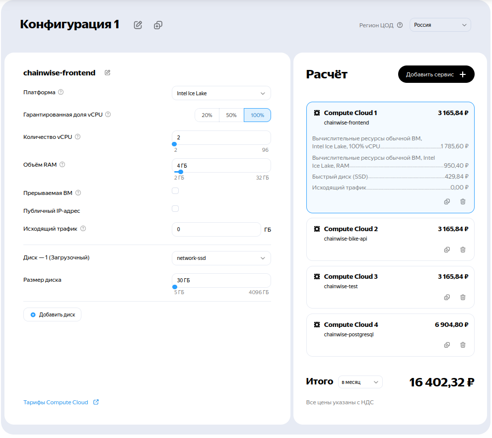

В конфигурации PostgreSQL сохранён SSD на 100 ГБ, поэтому после уменьшения CPU и
RAM диск по-прежнему стоит 1 432,80 ₽. Итоговая стоимость четырёх уменьшенных
конфигураций составляет 16 402,32 ₽.

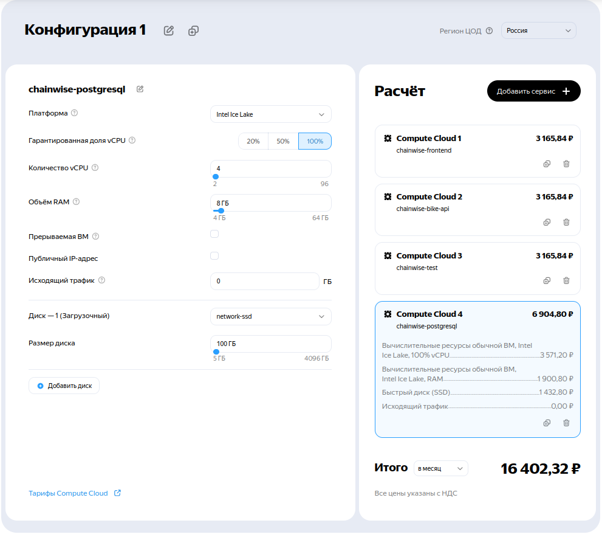

Перед реальным уменьшением PostgreSQL нужно собрать метрики хотя бы за несколько
недель и отдельно проверить пиковую память, IOPS и задержку запросов. Условные
40% и 50% показывают возможность оптимизации, но сами по себе не
заменяют наблюдение за production.

### 5.2. Auto-scaling

Группы `frontend` и `bike-api` работают минимум в трёх экземплярах, по одному в
каждой зоне. Средняя загрузка CPU выше 65% или больше 200 запросов в
секунду на экземпляр в течение пяти минут добавляет новые ВМ. При CPU ниже
35% и менее 100 запросов в секунду в течение 15 минут лишние ВМ
удаляются. Минимум равен трём, обычный пик обслуживают шесть экземпляров, а
максимум ограничен девятью.

Chainwise чаще используется перед утренними и вечерними поездками, поэтому с
07:00 до 10:00 и с 17:00 до 20:00 группа заранее увеличивается до шести
экземпляров. Ночью она возвращается к трём. Базовые три экземпляра покрываются
CVoS, а временные запускаются On-Demand. Прерываемые ВМ для пользовательского
API не используются, но подходят повторяемым фоновым задачам.

Один уменьшенный экземпляр стоит 3 165,84 ₽ за 720 часов. Если держать шесть
экземпляров постоянно, получится 18 995,04 ₽. При трёх постоянных экземплярах и
трёх дополнительных на шесть часов в день расчёт равен
`3 × 3 165,84 + 3 × 3 165,84 × 180 / 720`, то есть 11 871,90 ₽. Экономия по
сравнению с шестью постоянно работающими ВМ составляет 7 123,14 ₽ или
37,5%.

### 5.3. Классы хранения

Для сравнения во всех трёх классах использованы 100 ГБ, 10 000 операций чтения,
1 000 операций записи и нулевой исходящий трафик.

| Класс | Хранение | GET | POST | Итого | Экономия относительно STANDARD |
| --- | ---: | ---: | ---: | ---: | ---: |
| `STANDARD` | 235,22 ₽ | 0 ₽ | 0 ₽ | 235,22 ₽ | 0% |
| `COLD` | 126,72 ₽ | 1,15 ₽ | 1,39 ₽ | 129,26 ₽ | 45,05% |
| `ICE` | 63,36 ₽ | 2,30 ₽ | 2,79 ₽ | 68,45 ₽ | 70,90% |

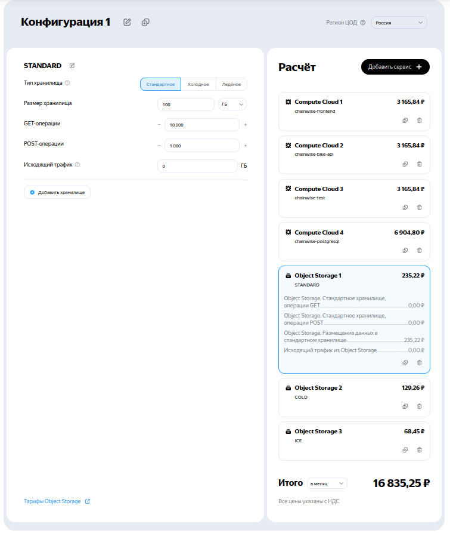

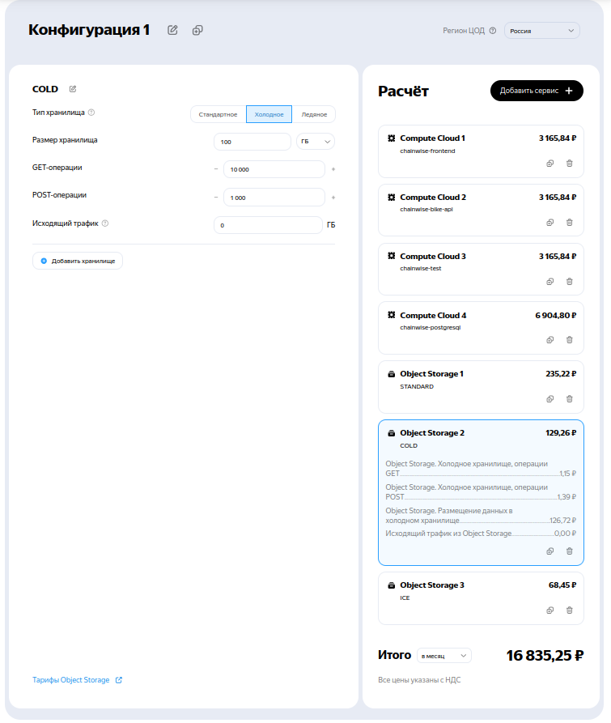

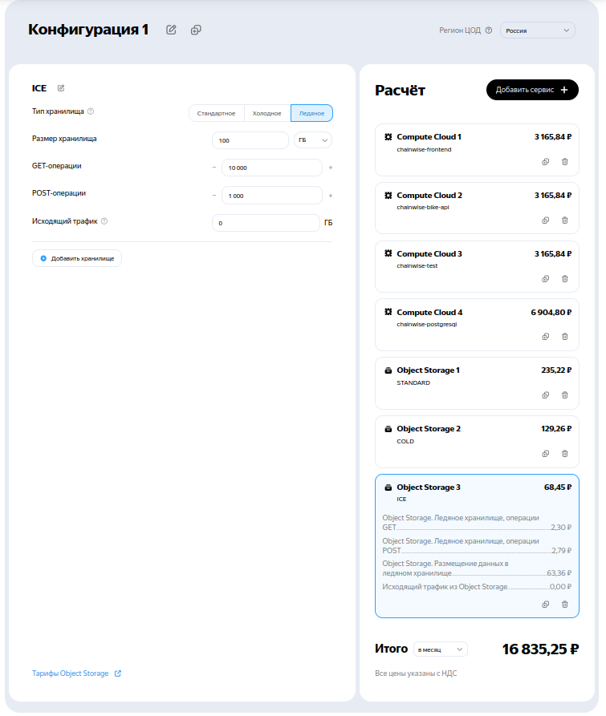

Новые файлы интерфейса, актуальные выгрузки и данные с частым чтением остаются
в `STANDARD`. Резервные копии и логи, к которым обращаются примерно раз в месяц,
переносятся в `COLD`. Годовые архивы истории обслуживания и старые резервные
копии размещаются в `ICE`, где высокая цена операций компенсируется редким
доступом. Короткоживущие данные нельзя сразу переносить в `ICE`, потому что для
этого класса действует минимальный срок хранения один год.

Для объектов с заранее неизвестной частотой доступа можно использовать
Intelligent Tiering. Он сам меняет уровень хранения по обращениям, но для
предсказуемых резервных копий явные правила жизненного цикла проще проверять и
планировать.

## Схема управления затратами

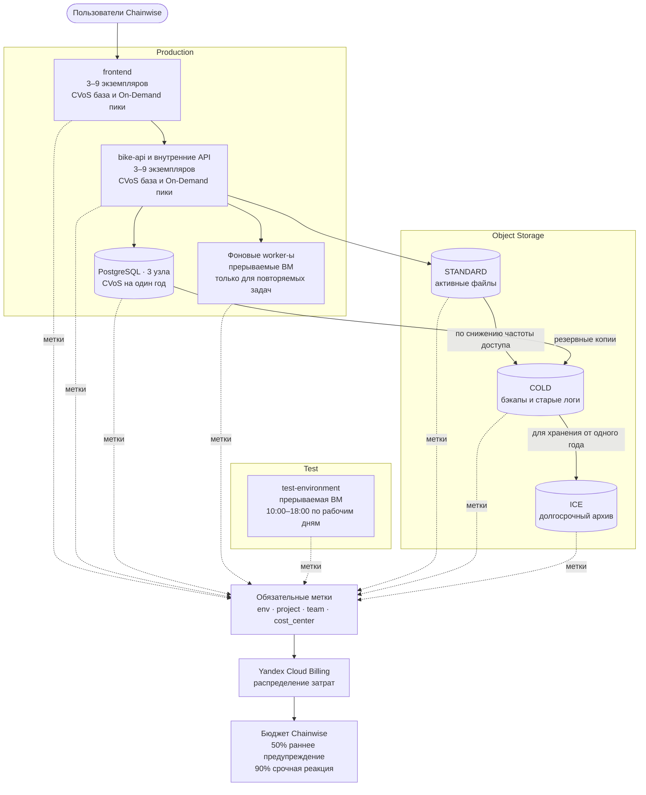

Исходник схемы находится в `scheme/finops.mmd`.

## Этап 6. Выводы

Для Chainwise одной модели оплаты недостаточно. CVoS подходит постоянной части
production, обычные ВМ сохраняют гибкость во время пиков, а прерываемый режим
снижает цену тестовой среды и повторяемых фоновых задач. В типовом сравнении по
одному экземпляру выбор моделей снижает цену на 24,45%. Для
трёхзонных production групп вместе с безопасным уменьшением stateless сервисов
экономия составляет 35,63%, а PostgreSQL сохраняет исходный размер.

Rightsizing даёт дополнительный потенциал, но его нельзя применять без метрик,
особенно для PostgreSQL. Auto-scaling убирает плату за шесть постоянно
работающих экземпляров, а классы Object Storage снижают стоимость старых данных.
Метки связывают каждый расход с окружением, проектом и командой, а бюджет
предупреждает о росте стоимости до того, как он станет неожиданным.

Демонстрационная ВМ использовалась только для проверки меток и после работы была
удалена вместе с загрузочным диском. Бюджет оставлен активным, поскольку сам по
себе он не создаёт платных ресурсов.

## Чек-лист самопроверки

- [x] Каждому сервису выбрана и обоснована модель цены
- [x] Стоимость рассчитана на калькуляторе Yandex Cloud
- [x] Экономия рассчитана в рублях и процентах
- [x] Для всех ресурсов заполнены `env`, `project`, `team` и `cost_center`
- [x] Объяснена проблема ресурса без обязательной метки
- [x] Демонстрационная ВМ создана и затегирована
- [x] Бюджет создан с порогами 50%, 90% и 100%
- [x] Rightsizing рассчитан для каждой ВМ
- [x] Для auto-scaling заданы метрики, пороги, время и границы группы
- [x] Три класса хранения сравнены по одинаковому профилю
- [x] Демонстрационная ВМ удалена после проверки
- [x] Итоговая экономия проекта рассчитана

## Контрольные вопросы

### 1. Чем отличаются On-Demand, Reserved и Spot

On-Demand не требует обязательств и оплачивается по фактическому времени, но
имеет самую высокую ставку. Reserved фиксирует объём на длительный срок и даёт
скидку, однако за неиспользованный резерв всё равно приходится платить. Spot
использует свободные мощности провайдера дешевле, но ВМ может быть остановлена.
Для круглосуточной PostgreSQL подходит CVoS как аналог Reserved, потому что её
нагрузка постоянна, а прерывание недопустимо.

### 2. Как работает принцип «база Reserved, пики Spot»

Предсказуемая минимальная мощность оплачивается по долгосрочной модели, а
кратковременный рост закрывается временными экземплярами. Для Chainwise базовые
узлы API и PostgreSQL покрываются CVoS. Пики пользовательского API безопаснее
обслуживать On-Demand, а Spot можно применять для worker-ов, которые сохраняют
позицию обработки и умеют повторять задачу после остановки.

### 3. Зачем нужны теги и проекты

Теги связывают стоимость с окружением, сервисом, командой и центром затрат. Без
них часть счёта попадёт в неизвестную категорию, у расхода не будет владельца, а
команда не сможет понять, какой ресурс нужно оптимизировать или удалить.

### 4. Какие инструменты используются у разных провайдеров

В AWS используется Cost Explorer, Budgets и Cost and Usage Report. В Azure для
этого есть Cost Management с бюджетами и рекомендациями. В Yandex Cloud
используются Billing, детализация потребления, бюджеты и CVoS. Все три варианта
дают разбивку расходов и прогноз, но названия моделей и возможности
резервирования отличаются.

### 5. Что такое Rightsizing

Rightsizing означает подбор vCPU, RAM, диска и других ресурсов по реальной
нагрузке. Главное правило состоит в том, что размер нельзя уменьшать вслепую.
Сначала собираются CPU, RAM, IOPS, сеть и пики хотя бы за несколько недель, а
после изменения оставляется запас и снова проверяются метрики.

### 6. Как Auto-scaling помогает экономить

Группа добавляет экземпляры только при росте запросов и удаляет их после
снижения нагрузки. Поэтому приложение выдерживает пик, но ночью не оплачивает
максимальное число ВМ. Для Chainwise плановый переход с шести постоянных ВМ на
три базовые и три временные экономит 37,5%.

### 7. Что делает S3 Intelligent-Tiering

Intelligent-Tiering наблюдает за обращениями к объектам и автоматически
перемещает их между уровнями доступа. Его используют, когда заранее неизвестно,
как часто будут читать данные. Ручные перемещения не нужны, но нужно учитывать
стоимость операций, мониторинга и минимальные сроки холодных уровней.

### 8. Какие фазы есть в FinOps

В фазе Inform расходы становятся видимыми через метки, отчёты и бюджеты. В фазе
Optimize выбираются модели оплаты, размеры ВМ, auto-scaling и классы хранения.
В фазе Operate правила применяются постоянно, команды получают алерты,
пересматривают прогноз и отвечают за свои расходы.

### 9. Чем опасна забытая тестовая ВМ

Обычная ВМ продолжает списывать деньги ночью и в выходные, даже если ей никто не
пользуется. Вместе с ней могут остаться диски, публичный адрес и снимки. Поэтому
тестовая среда Chainwise запускается по расписанию на прерываемой ВМ, а
временные ресурсы получают срок жизни и владельца через метки.

### 10. Почему без распределения затрат нельзя оптимизировать

Общий счёт показывает сумму, но не показывает причину. Без проекта, команды и
окружения нельзя отличить полезный production расход от забытого тестового
ресурса, назначить ответственного и проверить результат изменения.

### 11. Где использовалась симуляция, а где реальная практика

Конфигурации production, CVoS, прерываемый режим, rightsizing и классы хранения
считались на калькуляторе без создания этих ресурсов. Реально была создана одна
маленькая прерываемая ВМ с метками и бюджет с уведомлениями. После проверки ВМ
была удалена, поэтому практическая часть не оставила работающих платных
вычислительных ресурсов.
